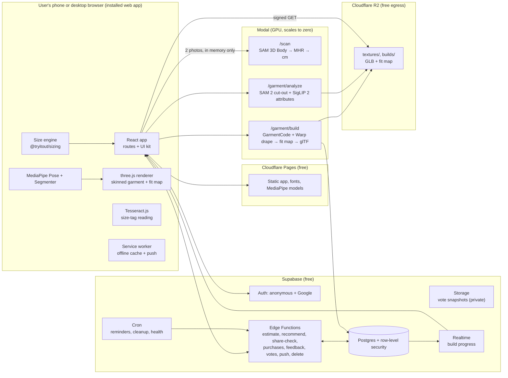

# Tryitout — Implementation Plan

| | |
|---|---|
| Product | **Tryitout**: your real size in every brand, and a fit check on your own body before you buy |
| Document version | 1.2 · 5 Nov 2026 (1.1 added §12.8 feel; 1.2 adds R2 asset storage, staging, Sentry and the launch upgrade) |
| Builders | You + Claude Code CLI running inside Google Antigravity |
| Target | V1 production release (6 core features), then V2 (9 more features) |
| Hosting budget | ₹0 to build and test (free tiers, hard usage caps); about $25/month (Supabase Pro) from the closed beta |
| Design source of truth | `design/screens/*.png` and `design/reference/*.html` (14 screens) |

> The canvas mockups used the placeholder name "FitSaathi". The product name is **Tryitout** everywhere: code, copy, manifest, domain, store listings. The design pack has already been renamed.

---

## Table of contents

0. How to use this document
1. Decisions locked
2. Feature list: final scope for V1 and V2
3. The problem
4. The solution
5. Research summary
6. User flows (V1)
7. System architecture
8. Tech stack and licences
9. Data model
10. API contracts
11. Core algorithms
12. UI system: exact spec
13. Repository layout and conventions
14. Agent orchestration (Antigravity + Claude Code)
15. V1 delivery plan, phase by phase
16. V2 delivery plan
17. Testing and quality
18. Production readiness checklist
19. Free-tier deployment runbook
20. Risks and mitigations
21. Sources

---

## 0. How to use this document

1. Create the repo (§13). Copy this file to the root as `implementation.md` and the design pack to `design/`.
2. Create `AGENTS.md`, `CLAUDE.md`, `.claude/agents/*` and `.claude/commands/*` exactly as given in §14. Antigravity reads `AGENTS.md`. Claude Code reads `CLAUDE.md`, which imports `AGENTS.md`.
3. Build one phase at a time from §15, in order. Every phase lists its goal, tasks, files, acceptance criteria and a ready-to-paste prompt.
4. A phase is done only when its acceptance criteria pass in CI, including the visual match against `design/screens`.
5. Keep `docs/progress.md` updated at the end of every phase (what shipped, what's left, decisions taken).

**Non-negotiables for every agent and every commit:**
- The fit check is built from real measurements and physics. Never use AI image generation to decide or show fit.
- Body photos are never stored. They are processed in memory and dropped. Only numbers are saved.
- No model, dataset or library with a non-commercial licence ships in the product (for example SMPL/SMPL-X).
- No scraping of shopping sites. Size data is curated by hand from public size charts or comes from partners.
- UI matches the design pack. Use tokens, never raw hex values.
- Scrolling is native: no scroll-jacking and no smooth-scroll libraries. Motion follows §12.8 and always has a reduced-motion version.
- No emoji in the UI. Use the icon set.
- Sample data from the mockups (Aarav, 98 cm chest, "88% sure") is only test fixtures, never shown to real users as fact.

---

## 1. Decisions locked

| Area | Decision | Why |
|---|---|---|
| Name | Tryitout | Your call. Replaces the placeholder "FitSaathi". |
| V1 platform | Installable web app (PWA): mobile-first, plus desktop layouts | Free to host and ship. Users install from the website. |
| Later platforms | Play Store and App Store by wrapping the same app with Capacitor (V2) | One codebase. Adds native share sheet on iPhone. |
| Frontend | React + Vite + TypeScript, Tailwind CSS v4 with design tokens, three.js, MediaPipe Tasks Vision | You already work in React + Vite. All of it is free and permissively licensed. |
| Backend | Supabase: Postgres, Auth (anonymous + Google), Storage, Edge Functions, Realtime | Free tier covers V1. One service for data, auth and APIs. |
| GPU jobs | Modal (Python, serverless GPU, scales to zero) | $30/month free credit. Pay per second, nothing when idle. |
| Web hosting | Cloudflare Pages | Free tier allows commercial use. |
| Asset storage | Cloudflare R2 for garment textures, GLBs and fit maps; Supabase Storage only for vote snapshots | 3D files are the heaviest downloads. R2 egress is free; Supabase Free allows 5 GB a month. |
| Environments | local → staging (second free Supabase project, Modal `staging` environment, a Cloudflare preview deploy per PR) → production | Nothing reaches users untested. |
| Monitoring | Sentry (web, Edge Functions, worker) with personal data scrubbed and session replay off | Crashes reported with stack traces from day one. |
| Launch upgrade | Supabase Pro ($25/month) before the closed beta (Phase 12), or earlier if a §19 trigger is hit | Daily backups, no pausing, 8 GB database, 250 GB egress. The only planned paid item. |
| Body model | MHR via SAM 3D Body for scans, Anny for typed details | Both usable commercially. SMPL/SMPL-X are non-commercial. |
| Garments in V1 | Tops only: T-shirts, oversized tees, polos, shirts (short and long sleeve) | Simple garments work first. Kurtas, jeans, dresses later. |
| Garment 3D | Parametric sewing templates (GarmentCode, MIT) sized from the brand's chart, cloth simulation, photo used for colour and print | Accurate fit without needing research models in V1. |
| Live camera | Runs entirely on the user's phone (MediaPipe pose + three.js) | No server cost per minute. Camera feed never leaves the phone. |
| Generative AI | Not used for fit. Optional later only to beautify a saved snapshot | Fit must come from centimetres, not pixels. |
| Privacy | Numbers only, photos never stored, 18+ in V1, DPDP-ready from day one | Trust, and India's DPDP Act. |
| Feel | Native scrolling, spring physics, page transitions with shared elements, press feedback on every tap; checked with frame-timing tests (§12.8) | "Feels like a great iPhone app" is a requirement, not a polish pass. |
| V1 scope | F1 Find My Size, F2 Try It On, F3 Share-to-check, F4 Ask Family, F5 Buy in my size, F6 Did it fit? | The first six in your finalised list. |
| V1 baseline (always included) | Consent and age gate, "Delete everything", desktop layouts, admin tool for size charts | Required for a production release. |
| V2 scope | Store Mode, Family profiles, Shoe size, Tailor card, Find it in my size, Ethnic + plus-size, Private lingerie fit, My language, Store apps | The rest of your list. |

---

## 2. Feature list: final scope for V1 and V2

Your finalised list is below, with the exact behaviour we will build. Where the original wording promised something that can't be built reliably for free, the change is marked **Adjusted** with the reason.

### V1: the six core features

**F1. Find My Size**
1. Open the app → "Your real size, in every brand." → start without login (anonymous account).
2. Choose how to measure:
   - **Type it**: height, weight, age, gender, body-shape picture (Slim / Athletic / Regular / Broad), fit preference (Slim / Regular / Relaxed).
   - **Scan me**: front + side photo in fitted clothes, height entered once (the camera needs height to know real cm).
3. "Your numbers": chest, waist, hip, shoulder, sleeve, inseam in cm, plus "Photos deleted".
4. Accuracy booster: "Got a shirt that fits perfectly? Scan its size tag" (on-device text recognition) or type brand + size.
5. Dashboard: every brand with my size and a fit tag, for example "Zara: M · Great fit". Category chips: Tops, Jeans, Kurtas, Shoes. **Adjusted:** V1 can only recommend categories that have size charts loaded. At launch that means tops and jeans. Kurtas and Shoes show "Coming soon" until V2 data exists.
6. Tap a brand → why: "Chest +6 cm room, ends mid-hip", size comparison S / M / L, IN/UK/US/EU equivalents when the brand publishes them.
7. Search any brand or fit line ("Uniqlo", "Levi's 511").
8. Brand missing → "Request this brand" → queue sorted by request count → added by the curation team. **Adjusted:** "every brand worldwide" grows through this queue. V1 launches with about 30 brands popular in India.
9. Sort "Brands that fit me best" (fit score first, then confidence).

**F2. Try It On**
1. "Try it on" → drop a shirt image, paste a link, or use the camera.
2. The shirt is cut out of the photo and the app suggests "Snitch oversized tee, right?". The user confirms brand, type and size. The recommended size is preselected. **Adjusted:** brand detection is a suggestion from the link, visible text on the garment, or the user. Plain tees have no visible brand, so the user always confirms.
3. A 3D shirt is built from the brand's real size chart for the chosen size, with the colour and print from the photo. **Adjusted:** in V1 the sewing pattern comes from a parametric template for the garment type (tee, polo, shirt), not from a research model that reads patterns from photos. Those models are the V2+ upgrade path (§5.3).
4. Physics drapes it on my 3D body from F1, so it hangs, stretches and folds by real measurements.
5. Camera opens → the shirt is on me live and moves as I turn, raise my arms or step back.
6. Fit overlay: Snug / Just right / Roomy colours, plus callouts like "Sleeve ends mid-bicep". Flip between M and L. **Adjusted:** the colours follow the design (orange / teal / blue), not red/green/blue, because red-green is the most common colour-blindness pair.
7. "Snap" → save or share the look.

**F3. Share-to-check**
- On Myntra (or Ajio, Amazon, Flipkart, brand sites) → Share → Tryitout → "Take L · Good fit" sheet.
- **Adjusted:** works from the share menu on Android once the web app is installed. iPhone web apps can't receive shares, so iPhone users paste the link (one tap with "Paste from clipboard"). The App Store version in V2 adds the share menu on iPhone.
- **Adjusted:** we read the brand and product type from the link itself. We never download the shop's page. If the link doesn't say enough, the sheet asks two quick questions (brand, type).

**F4. Ask Family**
- "Ask family" → WhatsApp opens with my try-on snapshot, the size, and a link → family votes "Looks good / Not sure / Skip it" on a web page, no app or login needed.
- Sharing a snapshot needs explicit consent each time. The link expires after 7 days and the photo is deleted then.
- **Adjusted:** the vote buttons use icons, not emoji (design rule).

**F5. Buy in my size**
- "Buy in L" → the original product opens in the store's app or site.
- **Adjusted:** other stores don't let outside apps preselect a size, so before leaving we show "Pick L on the next page". We record the intent (brand, size, product link) to power F6.

**F6. Did it fit?**
- When the user comes back from the store we ask "Did you buy it?". If yes, about 5 days later we send "How did it fit?" (web push on Android, and on iPhone once added to Home Screen) and show an in-app card.
- Answers: Too tight / Perfect / Too loose, where (Chest, Waist, Length, Sleeves, Shoulders), keeping or returning.
- The app updates my personal size offsets for that brand and shows what changes ("Next time we'll suggest M for H&M shirts").
- "People like you kept M" appears only once at least 20 similar users have answered for that brand and category. Below that it is hidden, never estimated.

**V1 baseline (not counted as features, but required for production):** consent screen and 18+ age gate, "My data → Delete everything", privacy policy and terms pages, desktop layouts (4.1, 4.2), admin tool for size charts and brand requests, error/empty/loading states.

### V2: the remaining nine features

| # | Feature | Behaviour | Notes |
|---|---|---|---|
| V2-1 | Store Mode | Pick store + category → "Grab M". Works offline. | Reuses the size engine on-device with cached charts. Small build: consider pulling into V1.1. |
| V2-2 | Family profiles | Add Maa, Papa, a child; switch profiles to see their sizes; kids' sizes move up as they grow. | Children's data needs verifiable parental consent under DPDP Rule 10 (§5.5). Store kids' profiles on the device only, or implement the consent flow. |
| V2-3 | Shoe size | Stand on an A4 sheet, one photo → size in Bata, Campus, Nike, Puma. | A4 corners give real scale. On-device. |
| V2-4 | Tailor card | Send measurements to a tailor on WhatsApp, with tips like "buy L, the tailor can take in 2 cm". | Image card + text share. |
| V2-5 | Find it in my size | Drop an Instagram screenshot → similar pieces in my size. | No free source of live stock across stores. V2a opens store searches. V2b needs partner feeds or affiliate APIs. |
| V2-6 | Ethnic + plus-size | Kurta / Blouse / Lehenga sizing for Indian cuts and plus-size bodies. | Needs charts and ease rules per garment type. |
| V2-7 | Private lingerie fit | 6 questions, no camera → bra size, stored only on the phone. | IndexedDB only, never sent to the server. |
| V2-8 | My language | Hindi, Telugu, Tamil; mic: "mera size batao". | i18n is built in from V1 (all copy in JSON). Voice uses the browser's speech recognition where available. |
| V2-9 | Store apps | Play Store and App Store builds. | Capacitor wrapper, native share extension on iPhone, store fees (§5.4). |

---

## 3. The problem

**Sizes don't mean the same thing across brands.** An M at Zara, Snitch and Zudio can differ by several centimetres at the chest, and brand charts mix body measurements with garment measurements. India has only recently published its own standard: the government-backed INDIAsize survey scanned 26,324 people across six cities [S7] and released 27 standard body size charts (13 for women, 14 for men), sold to industry at ₹20,000 per chart [S6]. Brands have not converged on it, so shoppers still guess.

**Guessing is expensive.** Fashion has the highest return rates in Indian e-commerce, around 25–40%, against a blended 25–30% across categories [S1][S2][S4]. Industry estimates attribute about 70% of fashion returns to poor fit [S3], and size accounts for over 60% of stated return reasons in footwear on Amazon and Flipkart India [S1]. Every return costs the shopper time (pickup, refund wait, re-order) and costs brands money on cash-on-delivery orders.

**The market keeps growing.** India's e-commerce market was about $125 billion in 2024 and is projected to reach $345 billion by 2030 [S5].

**Existing fixes are locked inside each store or only show looks.**
- Myntra says half its revenue now comes through system-driven size and fit recommendations [S8]. That proves recommendations change behaviour, but each store's advice only works inside that store, using that store's view of you.
- AI photo try-ons (Google's apparel try-on in India [S9], browser extensions for Myntra and Ajio [S10]) paint clothes onto your photo. They show style, not whether M or L will actually fit.

**The gap:** nobody gives an Indian shopper one body profile that works across every brand and store, plus a fit check based on real centimetres.

---

## 4. The solution

**Tryitout is a size passport plus a physics fit check.**

1. **Measure once.** Type five details or take two photos. Get your body numbers in centimetres. Photos are deleted immediately.
2. **Match every brand.** A size engine compares your body (and your preferred fit) against each brand's real size chart and returns a size, a fit tag and a confidence level.
3. **See the fit on you.** For any shirt, build a 3D garment from the brand's chart for the chosen size, drape it on your body with physics, and see it live through the camera with a fit map.
4. **Check anywhere you shop.** Share a product link from any store and get your size in seconds. Buy, then tell us whether it fitted. The app learns your personal offset per brand.

**Positioning:** "Fit, not filters." Every number on screen traces back to centimetres from your body and the brand's chart.

**Why it can win:**
- Works across all stores, so it becomes the shopper's habit before checkout anywhere.
- The "Did it fit?" loop creates outcome data per brand × body shape that a single store can't see across competitors. This is the long-term moat.
- Private by design: no photos stored, an 18+ app in V1, India-specific brands and body data.

**What Tryitout is not:** not a store, not a generative photo editor, not a social network.

---

## 5. Research summary

### 5.1 Market and users
- Fashion return rates of 25–40% and fit as the main reason, as shown in §3 [S1][S3][S4].
- Many D2C brands now ask buyers for size feedback after delivery and feed it into product pages [S5]. That confirms the value of the F6 loop.
- B2B fit widgets have existed in India for years (for example Fitrrati, which offered "Find Fit" questionnaires on Myntra, Snapdeal and Jabong) [S47]. The consumer-owned, cross-store angle is what's new here.
- Commercial body-scan APIs charge per scan (for example $2–5 per scan for measurements from two photos) [S26]. That's why Tryitout runs its own pipeline on open models.

### 5.2 Competitors and alternatives

| Alternative | What it does | Gap Tryitout fills |
|---|---|---|
| Myntra in-app size and fit recommendations [S8] | Recommends sizes inside Myntra | Only works on Myntra; no body profile you own; no physical fit view |
| Google AI apparel try-on in India [S9] | Generative photo of you wearing a product | Shows looks, not cm-level fit; no size engine |
| Chrome AI try-on extensions [S10] | Generative try-on on Amazon/Flipkart/Myntra/Ajio/Meesho | Same as above; desktop browsers only |
| Snap Lens Studio clothing try-on [S20] | Real-time AR garments using 3D body mesh, body tracking and cloth simulation | Brand-made lenses inside Snapchat; no size recommendation across brands |
| Snap Garment Transfer [S21] | Puts a garment image on you in real time | Limited to close-fitting shirts, so it can't show loose or oversized fits |
| Store size charts | Static tables | Users don't know their cm; charts mix body and garment cm |

### 5.3 Technology options we evaluated

| Option | Examples | Verdict |
|---|---|---|
| Real-time generative video editing | JoyAI-Video-Edit (16B parameters; 840×480 at 24 FPS on one RTX 5090; reference-guided garment edits are its weakest mode and still being improved) [S11] | **Rejected for fit.** It repaints pixels and has no input for centimetres, so M and L both look like they fit. One cloud GPU per live user (about $0.64/hour median for an RTX 5090 [S46]) breaks a free app. |
| Generative video try-on | MagicTryOn (distilled to 4 steps) [S12], OmniTryOn | Same problem: no sizes. Built for recorded video. Possible future "photo-real snapshot" only. |
| On-device generative video | Research reaches just over 10 FPS on an iPhone 16 Pro Max [S27] | Not viable live on mid-range Android in 2026. |
| Image → sewing pattern | SPnet (single image → pattern → physics drape) [S13]; ChatGarment (VLM outputs GarmentCode JSON) [S15]; Dress-1-to-3; Image2Garment (Stanford + Google: pattern plus fabric physics from one image) [S14]; PatternGSL (SIGGRAPH 2026, much higher reported pattern accuracy) [S16] | **V2+ upgrade path** for unusual garments. Check each licence first. V1 uses parametric templates, which is enough for tees and shirts. |
| Parametric sewing patterns + simulation | GarmentCode / pygarment (MIT licence) [S17], with simulation via NVIDIA Warp [S18] | **Chosen for V1.** Patterns are set directly from the brand's chart in cm. |
| Body models | SMPL/SMPL-X (non-commercial licence; commercial use only via Meshcapade) [S25] | **Rejected.** |
| | MHR (Apache 2.0) estimated by SAM 3D Body (weights under Meta's SAM License, which allows commercial use with pass-through terms) [S22][S23] | **Chosen for scans.** |
| | Anny (Apache 2.0, interpretable age/height/weight/muscle sliders, calibrated with WHO population statistics) [S24] | **Chosen for "Type it"** and readable measurements. |
| Real-time AR cloth on phones | Snap uses 3D body mesh + body tracking + cloth simulation [S20] | Confirms the physics approach is what production AR try-on uses. |
| Student precedent | HKU final-year project "Let's Dress Up": Android app for real-time try-on of any garment from one image, pose via ROMP over a server connection [S19] | Proves feasibility at student scale. Tryitout keeps pose on-device instead. |

Industry outlook pieces describe today's live AR try-on as a "stiff 3D overlay" and expect generative + live to merge later [S28]. Tryitout's plan: correct fit first (V1), photo-real snapshot later (V2+), photo-real live when costs allow.

### 5.4 Hosting and platform constraints (checked Nov 2026)

| Item | Fact | Impact |
|---|---|---|
| Cloudflare Pages | Free tier allows commercial use [S29] | Host the web app here. |
| Vercel Hobby | Personal, non-commercial use only [S30] | Don't use for Tryitout. |
| Supabase Free | 2 projects, 500 MB database, 1 GB files, 5 GB egress, 50,000 monthly active users [S31] | Enough for V1. |
| | Free projects pause after a week of low activity [S32] | Daily health check (§19). |
| | Built-in auth email is limited to a handful per hour, for testing only [S33] | Use anonymous + Google sign-in. No email/SMS codes. |
| | No automatic backups on Free; Pro ($25/month) adds daily backups kept 7 days, no pausing, 8 GB database and 250 GB egress [S63] | Weekly `pg_dump` until launch; move to Pro before the beta. |
| Cloudflare R2 | Free each month: 10 GB storage, 1M writes, 10M reads; egress always free [S61] | Garment textures, GLBs and fit maps live here. |
| Sentry Developer | Free for 1 user: 5,000 errors a month [S62] | Error monitoring for V1. Sample, and filter noise, so a bad release doesn't use the month up. |
| Modal Starter | $0 plus compute, $30/month free credit (full credit needs a card on file); T4 GPU $0.59/hour, per second [S34] | Scans and garment builds. Caps keep usage inside the credit. |
| Hugging Face Spaces | Creating Gradio/Docker Spaces now requires a paid plan [S35] | Not a free option. |
| Oracle Always Free | Arm allowance halved to 2 OCPU / 12 GB in June 2026 [S36] | CPU-only fallback if ever needed. |
| App stores | Google Play $25 once; Apple $99 per year [S37] | V2 only. |
| Android sideloading | Developer verification enforcement started Sept 2026 in four countries; India is part of the 2027 global rollout [S38] | APK downloads from the site work today; register before 2027. |
| iPhone web apps | No Web Share Target support [S39]; web push works on iOS 16.4+ once added to Home Screen (outside the EU) [S40] | F3 uses paste on iPhone. F6 asks iPhone users to add to Home Screen. |

### 5.5 Legal and privacy (India)
- The DPDP Act 2023 and DPDP Rules 2025 (notified 13 Nov 2025) phase in obligations. Notice and consent, breach reporting, security safeguards and verifiable consent for children apply from 14 May 2027 [S41]. The government has discussed shortening this timeline [S42], so Tryitout complies from day one.
- Anyone under 18 is a child. Processing their data needs verifiable parental consent (Rule 10) [S42]. V1 is 18+ only. V2 family profiles with children need a consent flow or device-only storage.
- Personal data breaches must be reported to the Data Protection Board within 72 hours [S43]. §18 includes the runbook.
- Body measurements are personal data. Body photos are never stored. Snapshots shared through Ask Family are stored only with consent and deleted after 7 days.
- Size charts: curate by hand from public brand pages, with the source URL and date. No automated scraping of stores. Brand names are shown as plain text for identification only, with no logos and a "not affiliated" line in the footer.
- Licences: every model and library must allow commercial use (§8). Several popular try-on and pattern models are research-only. Check before adding anything.

---

## 6. User flows (V1)

Screen IDs refer to the design pack (`design/screens`). "New" marks screens not in the canvas; they are specified in §12.6.

**Flow A: first open → sizes (Type it)**
1. 1.1 Welcome → "Type my details".
2. New: Consent + age gate (once per install).
3. 1.2 Type my details (step 1 of 2) → "See my sizes".
4. New: Your numbers (step 2 of 2) → editable values, "Photos deleted" note when coming from a scan → "Looks right".
5. 1.4 My sizes (dashboard).

**Flow B: Scan me**
1. 1.1 → "Scan me" → consent (if first time) → camera permission.
2. 1.3 Scan me: front photo (on-device checks: full body, light, arms away) → side photo (same screen, "Side photo · 2 of 2").
3. Upload both photos to the scan endpoint over HTTPS. Processed in memory and discarded.
4. New: Your numbers → 1.4.

**Flow C: Start with a brand size I already know**
1. 1.1 → link → 1.2 with the "Boost accuracy" card focused.
2. If only brand + size is given, measurements are estimated from that brand's chart (low confidence). The app then prompts for height and weight to improve it.

**Flow D: Brand detail**
1.4 → tap brand → 1.5 Brand fit detail → "Try it on in M" (Flow E) or "Shop Zara in M" (F5: opens brand site, records intent).

**Flow E: Try it on**
1. 2.1 Try it on → Gallery / Paste link / Camera → shirt cut out → suggestion "We found: …" → confirm brand, type, size → "Build my 3D try-on".
2. 2.2 Building (live progress from the job) → "Open live camera".
3. 2.3 Live fit check → toggle M/L compare, fit map, 3D view → Snap → save/share, or "Ask family" (F4).

**Flow F: Share-to-check + Buy**
1. Android: store app → Share → Tryitout (installed web app) → 3.1 sheet. iPhone/desktop: open Tryitout → paste link → 3.1.
2. 3.1 → "Buy in L" → reminder "Pick L on the next page" → store opens → intent saved.
3. On return to Tryitout → New: "Did you buy it?" sheet → Yes / No / Later.

**Flow G: Did it fit?**
Reminder (push or in-app card) → 3.2 Did it fit? → answer → "Save and update my sizes" → 1.4 shows updated sizes.

**Flow H: Ask family**
"Ask family" (2.3, 3.1, 4.2) → New: consent sheet ("Share a photo of you in this shirt? Link works for 7 days") → share via WhatsApp/share menu → family opens New: Vote page `/v/:token` → owner sees results on the try-on and in a dashboard card.

**Flow I: Delete everything**
3.4 Me → Privacy → "Delete everything" → confirm dialog → all rows and files for the user deleted, anonymous session cleared → back to 1.1.

**Desktop:** the same routes render the 4.1 / 4.2 layouts at ≥1024 px. Live camera on desktop uses the webcam.

---

## 7. System architecture



**Where each job runs**

| Job | Runs on | Why |
|---|---|---|
| Live camera, pose tracking, rendering, fit-map overlay | Phone | Free per minute; camera never leaves the device |
| Size-tag reading (OCR), scan quality checks | Phone | Free, private |
| Typed details → measurements (anny-lite model) | Edge Function (also bundled in the app for offline use later) | Milliseconds, no GPU |
| Size recommendations | Edge Function (same package also runs in the app) | Fast, consistent |
| Scan → measurements | Modal GPU | Needs a large model; photos processed in memory only |
| Garment cut-out, attributes, 3D build, drape | Modal GPU | Heavy; results cached and reused |
| Reminders, cleanup, health check | Supabase Cron | Free |

---

## 8. Tech stack and licences

Every dependency must allow commercial use. CI runs a licence check (§17).

| Layer | Choice | Licence |
|---|---|---|
| Language/build | TypeScript, Vite, pnpm workspaces, Node 22 LTS | Apache-2.0 / MIT |
| UI | React 19, React Router, TanStack Query, Zustand, Zod | MIT |
| Styling | Tailwind CSS v4 with tokens from §12.2 and motion tokens from §12.8.2 | MIT |
| Motion | Motion (`motion/react`): springs, exit animations, CSS spring generation (§12.8) | MIT |
| Sheets and dialogs | Base UI (`@base-ui/react`): Drawer (detents, swipe, indent, keyboard) and Dialog | MIT |
| Field performance | web-vitals (INP, LCP, CLS with attribution) | Apache-2.0 |
| Asset storage | Cloudflare R2 through its S3 API: `boto3` in the worker, `@aws-sdk/s3-request-presigner` in Edge Functions for signed URLs | Hosted; Apache-2.0 SDKs |
| Error monitoring | Sentry: `@sentry/react` (web), `@sentry/deno` (Edge Functions), `sentry-sdk` (worker) | Hosted; SDKs MIT |
| PWA | vite-plugin-pwa (Workbox): manifest, offline shell, share target, push | MIT |
| 3D | three.js (GLTFLoader + meshopt decoder) | MIT |
| Vision on device | @mediapipe/tasks-vision: Pose Landmarker, Image Segmenter | Apache-2.0 |
| OCR on device | Tesseract.js | Apache-2.0 |
| i18n | i18next + react-i18next (English in V1; hi/te/ta in V2) | MIT |
| Fonts (self-hosted) | Bricolage Grotesque, Instrument Sans, JetBrains Mono, Noto Sans Devanagari/Telugu/Tamil | SIL OFL 1.1 |
| Backend | Supabase: Postgres, Auth, Storage, Edge Functions (Deno), Realtime, Cron | Hosted (client libs MIT) |
| GPU worker | Modal, Python 3.11, FastAPI | Hosted / MIT |
| Body | SAM 3D Body (weights: SAM License, commercial use allowed with pass-through terms) + MHR (Apache-2.0); Anny (Apache-2.0) | See [S22][S24] |
| Garment cut-out | SAM 2 | Apache-2.0 |
| Garment attributes | SigLIP 2 (zero-shot) | Apache-2.0 |
| Patterns + drape | pygarment / GarmentCode (MIT) with its NVIDIA Warp simulator | MIT; check Warp's licence for the pinned version |
| Mesh tools | trimesh, numpy, scipy | MIT / BSD |
| Tests | Vitest, Playwright, pixelmatch, pytest | MIT / Apache-2.0 / ISC / MIT |

**Banned:** SMPL, SMPL-X, SMPLify and any model trained on them for commercial use [S25]; research-only try-on or pattern checkpoints; any scraping library pointed at shopping sites.

**Not used:** vaul (its repo says it is unmaintained [S53]); smooth-scroll libraries such as Lenis or Locomotive (native scrolling only, §12.8.1).

---

## 9. Data model

Supabase Postgres. All tables have row-level security (RLS). Migrations live in `supabase/migrations/`.

```sql
-- 0001_init.sql
create extension if not exists pgcrypto;

create type gender_t        as enum ('man','woman','other');
create type shape_t         as enum ('slim','athletic','regular','broad');
create type fit_pref_t      as enum ('slim','regular','relaxed');
create type fit_style_t     as enum ('slim','regular','relaxed','oversized');
create type measure_src_t   as enum ('typed','scan','anchor_only');
create type category_t      as enum ('tshirt','oversized_tee','polo','shirt','jeans','trousers','kurta','shoes');
create type chart_kind_t    as enum ('body','garment');
create type fit_tag_t       as enum ('great','good','slightly_tight','slightly_loose','not_recommended');
create type build_status_t  as enum ('queued','running','done','failed');
create type verdict_t       as enum ('too_tight','perfect','too_loose');
create type keep_t          as enum ('keeping','returning','not_sure');
create type vote_choice_t   as enum ('looks_good','not_sure','skip_it');

create table profiles (
  id uuid primary key references auth.users(id) on delete cascade,
  display_name text,
  is_adult boolean not null default false,
  consent_version text,
  consented_at timestamptz,
  locale text not null default 'en',
  created_at timestamptz not null default now()
);

create table body_profiles (
  id uuid primary key default gen_random_uuid(),
  owner_id uuid not null references profiles(id) on delete cascade,
  label text not null default 'self',            -- V2 adds family members
  gender gender_t not null,
  age_years smallint check (age_years between 18 and 100),
  height_cm numeric(5,1) check (height_cm between 120 and 220),
  weight_kg numeric(5,1) check (weight_kg between 30 and 250),
  shape shape_t,
  fit_pref fit_pref_t not null default 'regular',
  created_at timestamptz not null default now(),
  updated_at timestamptz not null default now()
);

create table measurements (
  id uuid primary key default gen_random_uuid(),
  body_profile_id uuid not null references body_profiles(id) on delete cascade,
  source measure_src_t not null,
  chest_cm numeric(5,1), waist_cm numeric(5,1), hip_cm numeric(5,1),
  shoulder_cm numeric(5,1), sleeve_cm numeric(5,1), inseam_cm numeric(5,1), neck_cm numeric(5,1),
  sigma jsonb not null default '{}',               -- per-measurement uncertainty, cm
  quality numeric(3,2) check (quality between 0 and 1),
  model_version text not null,
  is_current boolean not null default true,
  created_at timestamptz not null default now()
);
create unique index one_current_measurement on measurements(body_profile_id) where is_current;

create table brands (
  id uuid primary key default gen_random_uuid(),
  slug text unique not null,                       -- 'h-and-m'
  name text not null,                              -- 'H&M'
  monogram text not null,                          -- 'H&M', 'Zu'
  aliases text[] not null default '{}',            -- {'hm','h and m'}
  website_url text,
  is_active boolean not null default true,
  created_at timestamptz not null default now()
);

create table size_charts (
  id uuid primary key default gen_random_uuid(),
  brand_id uuid not null references brands(id) on delete cascade,
  category category_t not null,
  gender gender_t not null,
  fit_line text not null default 'Regular',        -- 'Regular', 'Slim', '511 Slim'
  fit_style fit_style_t not null default 'regular',
  kind chart_kind_t not null,                      -- body or garment measurements
  source_url text not null,
  source_checked_on date not null,
  verified_by uuid[] not null default '{}',        -- two curators must verify
  version int not null default 1,
  is_live boolean not null default false,
  unique (brand_id, category, gender, fit_line, version)
);

create table size_chart_rows (
  id uuid primary key default gen_random_uuid(),
  chart_id uuid not null references size_charts(id) on delete cascade,
  size_label text not null,                        -- 'M', '40', '32'
  sort_order smallint not null,
  chest_min numeric(5,1), chest_max numeric(5,1),
  waist_min numeric(5,1), waist_max numeric(5,1),
  hip_min numeric(5,1),   hip_max numeric(5,1),
  shoulder numeric(5,1), length numeric(5,1), sleeve numeric(5,1), inseam numeric(5,1),
  conv_in text, conv_uk text, conv_us text, conv_eu text   -- only if the brand publishes them
);

create table anchors (                             -- "a size that already fits me"
  id uuid primary key default gen_random_uuid(),
  body_profile_id uuid not null references body_profiles(id) on delete cascade,
  brand_id uuid references brands(id),
  brand_text text,
  category category_t not null,
  size_label text not null,
  source text not null check (source in ('typed','size_tag')),
  created_at timestamptz not null default now()
);

create table brand_requests (
  id uuid primary key default gen_random_uuid(),
  name_raw text not null,
  name_norm text not null,
  requester_id uuid references profiles(id) on delete set null,
  created_at timestamptz not null default now()
);

create table garments (
  id uuid primary key default gen_random_uuid(),
  owner_id uuid references profiles(id) on delete cascade,
  brand_id uuid references brands(id),
  category category_t not null,
  attrs jsonb not null default '{}',               -- sleeve, neckline, fit_style, fabric
  color_hex text,
  texture_path text,                               -- storage: textures/<garment_id>.webp
  created_at timestamptz not null default now()
);

create table garment_builds (
  id uuid primary key default gen_random_uuid(),
  garment_id uuid not null references garments(id) on delete cascade,
  size_label text not null,
  body_bucket text not null,                       -- quantised body key, see §11.6
  status build_status_t not null default 'queued',
  progress smallint not null default 0,
  step text,                                       -- 'cutout','pattern','size','drape','export'
  glb_path text, fitmap jsonb, error text,
  created_at timestamptz not null default now(),
  finished_at timestamptz,
  last_used_at timestamptz not null default now(),
  unique (garment_id, size_label, body_bucket)
);

create table share_checks (
  id uuid primary key default gen_random_uuid(),
  user_id uuid not null references profiles(id) on delete cascade,
  url text not null, domain text not null,
  parsed jsonb not null, result jsonb,
  created_at timestamptz not null default now()
);

create table purchase_intents (
  id uuid primary key default gen_random_uuid(),
  user_id uuid not null references profiles(id) on delete cascade,
  brand_id uuid references brands(id),
  category category_t not null,
  size_label text not null,
  product_url text,
  source text not null check (source in ('share_check','brand_detail','try_on')),
  status text not null default 'opened' check (status in ('opened','bought','not_bought')),
  remind_at timestamptz,
  created_at timestamptz not null default now()
);

create table fit_feedback (
  id uuid primary key default gen_random_uuid(),
  purchase_id uuid not null references purchase_intents(id) on delete cascade,
  user_id uuid not null references profiles(id) on delete cascade,
  verdict verdict_t not null,
  regions text[] not null default '{}',            -- chest, waist, length, sleeves, shoulders
  keeping keep_t not null,
  created_at timestamptz not null default now()
);

create table user_brand_offsets (                  -- learned from fit_feedback (§11.5)
  user_id uuid not null references profiles(id) on delete cascade,
  brand_id uuid not null references brands(id),
  category category_t not null,
  region text not null,
  offset_cm numeric(4,1) not null default 0,
  n int not null default 0,
  primary key (user_id, brand_id, category, region)
);

create table family_votes (
  id uuid primary key default gen_random_uuid(),
  owner_id uuid not null references profiles(id) on delete cascade,
  token text unique not null,                      -- 128-bit random, URL-safe
  snapshot_path text,                              -- null when shared without photo
  brand_name text not null, size_label text not null, note text,
  expires_at timestamptz not null,                 -- created_at + 7 days
  created_at timestamptz not null default now()
);

create table family_vote_responses (
  id uuid primary key default gen_random_uuid(),
  vote_id uuid not null references family_votes(id) on delete cascade,
  choice vote_choice_t not null,
  voter_name text check (char_length(voter_name) <= 40),
  ip_hash text not null,                           -- salted hash, for rate limiting only
  created_at timestamptz not null default now()
);

create table push_subscriptions (
  id uuid primary key default gen_random_uuid(),
  user_id uuid not null references profiles(id) on delete cascade,
  endpoint text unique not null, p256dh text not null, auth text not null,
  created_at timestamptz not null default now()
);

create table usage_counters (                      -- free-tier guard rails
  user_id uuid not null references profiles(id) on delete cascade,
  day date not null,
  scans smallint not null default 0,
  analyses smallint not null default 0,
  builds smallint not null default 0,
  primary key (user_id, day)
);

create table events (                              -- first-party analytics, no PII in props
  id bigint generated always as identity primary key,
  user_id uuid references profiles(id) on delete cascade,
  name text not null, props jsonb not null default '{}',
  created_at timestamptz not null default now()
);

create table admin_users (user_id uuid primary key references auth.users(id) on delete cascade);
```

**RLS rules (write these as migrations with tests):**
- Own-data tables (`profiles`, `body_profiles`, `measurements`, `anchors`, `garments`, `share_checks`, `purchase_intents`, `fit_feedback`, `user_brand_offsets`, `family_votes`, `push_subscriptions`, `usage_counters`, `events`): `using (owner_or_user_id = auth.uid())` for select/insert/update/delete. Child tables check ownership through the parent.
- Public read: `brands` (`is_active`), `size_charts` + `size_chart_rows` (`is_live`). Writes only for `admin_users`.
- `garment_builds`: read if the caller owns the garment, or through a signed URL for cached public builds. Writes only by the service role (Modal).
- `family_votes` and `family_vote_responses`: no direct public access. Expose two `security definer` functions, `get_vote(token)` (safe fields + counts, only if not expired) and `respond_vote(token, choice, name)` (rate limited per `ip_hash`: 1 response per vote per hour).
- `brand_requests`: insert for any authenticated user (rate limited, 5 per day); select for admins.

**Storage:**
- Cloudflare R2 bucket `tryitout-assets` (private): `textures/<garment_id>.webp` and `builds/<buildId>/garment.glb` + `fitmap.json`. Only the worker writes (S3 API keys in its Modal secret). Clients read through short-lived signed URLs from `POST /asset-urls`. `texture_path` and `glb_path` hold R2 keys.
- Supabase Storage bucket `vote-snapshots` (private, signed URL from `get_vote`, deleted at expiry). It stays in Supabase because its access rules live in Postgres.
- There is **no bucket for body photos**, in either service.

**Retention jobs (Supabase Cron, daily):** delete expired `family_votes` and their snapshots; delete `events` older than 180 days; delete `garment_builds` and files unused for 90 days; delete `share_checks` older than 180 days; keep only the last 5 `measurements` per body profile.

---

## 10. API contracts

All Edge Functions live in `supabase/functions/<name>`, accept and return JSON, validate input with Zod, and require `Authorization: Bearer <supabase access token>` unless marked public. Errors use `{ "error": { "code": "string", "message": "string" } }`.

| Function | Request | Response |
|---|---|---|
| `POST /body-estimate` | `{ gender, ageYears, heightCm, weightKg, shape, fitPref, anchor?: { brandSlug?, brandText?, category, size } }` | `{ bodyProfileId, measurements: { chest, waist, hip, shoulder, sleeve, inseam, neck }, sigma: {…}, source: "typed", quality, modelVersion }` |
| `POST /recommend` | `{ bodyProfileId, category, brandSlugs?: string[], q?: string }` | `{ engineVersion, items: [ { brand: { slug, name, monogram }, fitLine, size, fitTag, confidence: { level: "high"\|"medium"\|"low", p: number\|null }, note, regions: [ { name, easeCm, band: [min,max], status } ], alternatives: [ { size, fitTag } ], conversions?: { IN?, UK?, US?, EU? } } ] }` |
| `GET /brands?q=` | query string | `{ items: [ { slug, name, monogram, categories, fitLines } ], canRequest: boolean }` |
| `POST /brand-requests` | `{ name }` | `{ ok: true }` |
| `POST /share-check` | `{ text }` (shared text or URL) | `{ shareCheckId, parsed: { domain, brandSlug?, category?, fitStyle?, productId? }, needs: ("brand"\|"category")[], result?: RecommendItem }` |
| `POST /share-check/:id/complete` | `{ brandSlug?, category? }` | `{ result: RecommendItem }` |
| `POST /purchases` | `{ brandSlug, category, size, productUrl?, source, shareCheckId? }` | `{ purchaseId }` |
| `PATCH /purchases/:id` | `{ status: "bought"\|"not_bought", remindInDays?: number }` | `{ ok: true }` |
| `POST /feedback` | `{ purchaseId, verdict, regions, keeping }` | `{ changes: [ { brandSlug, category, nextSize, message } ] }` |
| `POST /votes` | `{ snapshotPath?, brandName, size, note? }` | `{ token, url, expiresAt }` |
| `GET /votes/:token` (public) | – | `{ ownerFirstName, brandName, size, snapshotUrl?, expiresAt, counts: { looks_good, not_sure, skip_it } }` |
| `POST /votes/:token/respond` (public) | `{ choice, name? }` | `{ ok: true, counts }` |
| `POST /push-subscribe` | `{ endpoint, keys: { p256dh, auth } }` | `{ ok: true }` |
| `POST /asset-urls` | `{ buildId }` or `{ garmentId }` | `{ glbUrl?, fitmapUrl?, textureUrl, expiresAt }` (R2 signed GET URLs, 1 hour; caller must own the garment or the build must be a shared cached build) |
| `POST /account-delete` | – | `204` (deletes auth user → cascades; deletes Supabase Storage under `users/<uid>/` and the user's garment textures and builds in R2) |

**Modal worker endpoints** (`apps/worker`). Every call carries the user's Supabase JWT, verified against the project's JWKS. The worker writes results to Supabase with the service-role key, stored as a Modal secret.

| Endpoint | Request | Response | Notes |
|---|---|---|---|
| `POST /scan` | multipart: `front`, `side` (JPEG, ≤1600 px long edge, ≤2 MB each), `heightCm`, `gender` | `{ measurements, sigma, quality, checks: { fullBody, poseOk, agreement }, modelVersion }` or `422 { reason }` | Images live only in RAM; never written to disk or logs. Counts against `usage_counters.scans`. |
| `POST /garment/analyze` | multipart `image` or `{ imageUrl }` (user-provided link to an image file) | `{ garmentId, cutoutUrl, colorHex, suggest: { category, sleeve, neckline, fitStyle, brand: { slug?, source: "url"\|"ocr"\|"none" } } }` | Cut-out stored in R2 as the garment texture. |
| `POST /garment/build` | `{ garmentId, size, bodyProfileId, compareSize? }` | `{ buildId }` (async) | Progress via Realtime on `garment_builds` (`status`, `progress`, `step`). Cached builds return instantly. |

Build output in R2 under `builds/<buildId>/`. The service worker caches each GLB by `buildId` (Cache Storage, up to 50 MB, oldest evicted first), so reopening a try-on downloads nothing: `garment.glb` (meshopt-compressed, skinned, fit values as a vertex attribute) and `fitmap.json`:

```json
{
  "size": "L",
  "regions": {
    "chest":     { "status": "right", "easeCm": 18.0 },
    "biceps":    { "status": "snug",  "easeCm": 2.0 },
    "waist":     { "status": "roomy", "easeCm": 22.5 },
    "shoulders": { "status": "right", "dropCm": 5.0 }
  },
  "callouts": [
    { "region": "chest",  "title": "Just right", "detail": "Shoulders & chest", "anchorVertex": 1532 },
    { "region": "biceps", "title": "Snug",       "detail": "Biceps +2 cm",      "anchorVertex": 4410 },
    { "region": "waist",  "title": "Roomy",      "detail": "Waist, by design",  "anchorVertex": 2876 }
  ],
  "landmarks": { "hem": "hip", "sleeveEnd": "mid_bicep" },
  "verdict": { "fitTag": "good", "summary": "L fits well and ends at your hip." }
}
```

---

## 11. Core algorithms

### 11.1 Typed details → measurements (anny-lite)
Offline tool `tools/anny-precompute` (Python, runs once per model version):
1. Sample about 200k adult bodies from Anny's phenotype space (gender, age, height, weight, muscle, proportions), using its population-calibrated priors [S24].
2. For each body: height from the mesh, weight from mesh volume × one documented average body-density constant, and all measurements with the slicing method in §11.2 step 6.
3. Map the four body-shape pictures to phenotype priors: Slim (low weight and muscle), Athletic (high muscle, broader shoulders), Regular (median), Broad (higher weight and width).
4. Train a small regressor (gradient-boosted trees) from `(gender, age, height, weight, shape)` → `(chest, waist, hip, shoulder, sleeve, inseam, neck)`, plus a residual standard deviation per output (this becomes `sigma`).
5. Export as JSON into `packages/anny-lite` with a tiny TypeScript evaluator. It runs in the Edge Function now, and in the browser for offline use in V2.
6. Report error on held-out synthetic bodies and on the real accuracy study (§17.5).

**Anchor fusion:** if the user gives a brand + size that fits, convert it to a measurement interval (body chart: that row's range; garment chart: row value minus that fit style's target ease). Combine with the estimate by precision-weighted averaging. This lowers `sigma` and raises confidence. Size-tag OCR on the phone fills the same anchor (brand, size, and the chest cm if printed on the tag).

**Brand-size-only path (Flow C):** with no body data, invert the anchor interval to get measurements, mark `source = anchor_only`, and set confidence to Low until height and weight are added.

### 11.2 Scan → measurements
1. **On-device checks** during preview (MediaPipe Pose): all key landmarks visible (visibility > 0.6); body fills 70–90% of frame height; arms 15–35° away from the torso; average brightness within range; phone roughly upright (device orientation within ±10°). These drive the checklist chips on 1.3. The shutter enables only when all checks pass. Offer a 10-second self-timer.
2. **Capture** the front photo, then the side photo (same screen, "Side photo · 2 of 2").
3. **Upload** both JPEGs straight to `/scan` over HTTPS. Never to Storage, never logged.
4. **Infer** body shape and pose with SAM 3D Body on each image → MHR parameters [S22][S23]. Average the shape parameters weighted by detection confidence. Reject with `422 { reason: "views_disagree" }` if the two views disagree beyond a threshold.
5. **Scale** the mesh to the user's height (crown to floor) in a neutral pose.
6. **Measure** with plane slices at landmark heights. Girth is the perimeter of the slice's convex hull, which behaves like a tape measure.
   - chest: maximum girth at armpit level
   - waist: minimum girth between the lowest rib and the hip bone
   - hip: maximum girth over the buttocks
   - shoulder: surface distance between the shoulder points across the back
   - sleeve: shoulder point to wrist along the arm
   - inseam: crotch to floor
   - neck: girth at the base
7. **Quality** = pose confidence × view agreement × check results. Return numbers, `sigma` and quality. The buffers are freed when the request ends.
8. **Claim discipline:** the "Most accurate" pill on 1.1 ships only after the accuracy study (§17.5) shows scan error below typed error. Until then the pill is hidden by a flag.

### 11.3 Size engine (`packages/sizing`)
Pure TypeScript, deterministic, versioned (`engineVersion`), shared by the app and Edge Functions.

**Inputs:** measurements with `sigma`, `fitPref`, category, chart (rows, kind, fit style), and the user's learned offsets.

**Steps for each brand chart:**
1. **Normalise** the chart: half-chest (flat) × 2, inches × 2.54, ranges to `[min, max]`.
2. **Ease per size row and region:**
   - Garment chart: `ease = garment − body`.
   - Body chart: `ease = (rowMid − body) + nominalEase(category, fitStyle)`.
3. **Target band** comes from `ease_targets(category, fitStyle, region)`, shifted by `fitPref` (slim −2 cm, relaxed +3 cm on chest and waist) and by the user's learned offset.
4. **Deviation** `d = (ease − bandMid) / (bandHalfWidth + sigma)`.
5. **Score** `S = Σ w·d²`, plus a penalty when any `|d| > 2.5`.
   - Weights for tops: chest 0.45, waist 0.20, shoulder 0.20, length 0.15.
   - Weights for jeans: waist 0.50, hip 0.30, inseam 0.20.
6. **Pick** the lowest S. The neighbouring sizes become `alternatives`.
7. **Fit tag** from the primary regions:
   - `great`: all `|d| ≤ 1`
   - `good`: `|d| ≤ 1.6`
   - `slightly_tight`: −2.5 < d < −1.6
   - `slightly_loose`: 1.6 < d < 2.5
   - otherwise `not_recommended`, and the next size is suggested
8. **Confidence** `p` is a logistic function of: measurement quality, `sigma`, chart kind (garment > body), the score gap between the best and second-best size, and the feedback count.
   - Level: High ≥ 0.8, Medium 0.6–0.8, Low < 0.6.
   - The UI chip shows the level text ("High confidence"). It shows a percentage ("88% sure", as in the mockups) only once that brand × category has ≥ 200 "Did it fit?" outcomes, `p` has been calibrated (isotonic regression) and the Brier score is tracked. This keeps every number on screen honest.
9. **Notes** are generated from the regions. Patterns: "+6 cm room at chest", "Runs small at the chest", "You are between M and L", "Matches the M you own", "Slim cut, M is tight at chest".
10. **Conversions** (IN/UK/US/EU) are shown only when the brand publishes them in its own chart. Never invented.

**`ease_targets` starting values (cm).** These are heuristics from common pattern-making practice. They are tuned by "Did it fit?" data and stored in a table, never hard-coded.

| Category / region | Slim | Regular | Relaxed | Oversized |
|---|---|---|---|---|
| T-shirt chest | 4–8 | 8–14 | 14–20 | 20–30 |
| Polo chest | 6–10 | 10–14 | 14–20 | – |
| Shirt chest | 6–10 | 10–16 | 16–22 | – |
| Shirt waist | 6–12 | 12–20 | 20–28 | – |
| Shoulder (garment − body) | −1 to +1 | 0 to +2 | +1 to +4 | +4 to +10 (drop shoulder) |
| Jeans waist | −1 to +1 | 0 to +2 | +1 to +3 | – |
| Length (tops) | ends mid-hip | mid-hip to low-hip | low-hip | low-hip or below |

**Golden tests:** fixtures reproduce the mockup data (Aarav: 175 cm, 72 kg, 24, Athletic, Regular, chest 98 / waist 84 / hip 96 / shoulder 45, Roadster M anchor). The fixture charts must yield Zara M great, Uniqlo M great, Roadster M great, H&M L good, Snitch L good, Zudio L slightly loose. These fixtures also drive the visual tests.

### 11.4 Share URL parser (`packages/urlparse`)
1. Pull the first URL out of the shared text. Android often puts the link inside `text`, not `url`.
2. Resolve known short links (for example `amzn.in`, `myntr.it`) by following redirects with HEAD requests, at most 3 hops, from the Edge Function. Never download the page body.
3. Run domain adapters that read the path only. Example patterns are below. Verify each against real links during Phase 7 and keep them as test fixtures.
   - `myntra.com/{category}/{brand}/{slug}/{id}/buy` → brand, category and title words
   - `ajio.com/{slug}/p/{id}` → brand from the first slug token(s) via the brand dictionary
   - `amazon.in/{Title-Slug}/dp/{ASIN}` → brand and category from title words
   - `flipkart.com/{slug}/p/{itemId}` → same
   - Brand stores (`/products/{slug}` on Shopify-style shops; Zara `…-p{id}.html`; H&M `productpage.{id}.html`) → brand from the domain, category from the slug if present
4. Match words against the brand dictionary (aliases), category keywords (tshirt|t-shirt|tee, polo, shirt, jeans, trousers, kurta) and fit keywords (slim, regular, relaxed, oversized, boxy, loose).
5. If brand and category are found, answer straight away. If not, return `needs`, and the sheet asks with chips, then calls `/share-check/:id/complete`.

### 11.5 Learning from "Did it fit?"
- **Personal offsets:** each answer updates `user_brand_offsets` for the regions the user ticked (or the primary region if none).
  - Too tight → +k cm. Too loose → −k cm. Perfect → move the offset halfway toward 0.
  - `k = 2 / (1 + n/3)`, so later answers move the offset less.
  - The next recommendation for that brand changes, and the response says what changed ("Next time we'll suggest M for H&M shirts").
- **Brand corrections:** a nightly job aggregates residuals by brand × category × fit line × body bucket. With n ≥ 20 it proposes a band shift (bounded to ±4 cm). An admin approves it before it goes live, so one batch of noisy answers can't drift the engine.
- **"People like you kept M":** cohort = same gender, same shape, chest ±3 cm, height ±5 cm. Show only if n ≥ 20 and one size has ≥ 50% of "keeping" answers. Otherwise hide the line.

### 11.6 Garment build pipeline (Modal)
1. **Cut out** (`/garment/analyze`): SAM 2 with an automatic prompt. For a photo of a model, the prompt is the torso centre from a pose detector. For a flat-lay, it's the largest foreground object. Output is an RGBA cut-out.
2. **Attributes:** SigLIP 2 zero-shot over fixed label sets: category {tshirt, oversized_tee, polo, shirt}, sleeve {short, long}, neckline {crew, v, collar}, fit {slim, regular, relaxed, oversized}. Brand comes from the link (if given) or OCR on visible text, else none. The user confirms on 2.1.
3. **Pattern:** map the category to a GarmentCode template (tee / polo / shirt programs). Set panel dimensions from the brand's chart for the chosen size:
   - Garment chart: chest, length, shoulder and sleeve are used directly.
   - Body chart: the row mid plus the target ease from §11.3.
4. **Fabric preset** by category: jersey for tees and polos, woven cotton for shirts. Each preset holds stretch, bend and density.
5. **Texture:**
   - Base colour = dominant colour of the cut-out.
   - Front print = the cut-out warped onto the front panel's UV space, using contour landmarks (neck centre, shoulder points, hem corners).
   - Back = base colour, unless the user adds a back photo.
6. **Drape** on the user's body mesh in A-pose with the GarmentCode / Warp simulator [S17][S18].
7. **Fit map:** per-vertex garment-to-body distance and stretch ratio → snug / right / roomy per region. Compute callout anchors and landmarks (where the hem and sleeve end land on the body).
8. **Rig and export:** transfer skin weights from the body to the garment (nearest surface point), write `garment.glb` (meshopt) and `fitmap.json`, then update `garment_builds` (`step`, `progress`, `status`).
9. **Cache key:** `(garment_id, size, body_bucket)`. `body_bucket` = gender + height rounded to 2 cm + chest/waist rounded to 2 cm + shoulder rounded to 1 cm. Users with the same bucket reuse the build instantly.
10. **Targets:** first build p90 ≤ 90 s including cold start; cached ≤ 3 s. Measure these on the real deployment and adjust the GPU type.
11. **Limits:** tops only in V1. Show a clear message for other garment types: "Try-on supports T-shirts, polos and shirts for now."

### 11.7 Live try-on renderer (browser)
Per frame:
1. `getUserMedia` at 720p (480p on low-end devices). Front camera by default, with a switch.
2. Pose Landmarker in VIDEO mode with the GPU delegate → image and world landmarks, smoothed with a One-Euro filter.
3. Image Segmenter (selfie) every second frame → person mask.
4. Rig update:
   - Torso frame from the shoulders and hips → garment root transform.
   - Scale from the user's real shoulder width (cm) against the landmark distance.
   - Upper-arm and forearm bone rotations from shoulder→elbow and elbow→wrist vectors.
   - Spine bend from the shoulder and hip midpoints.
5. Render with three.js, using an orthographic camera matched to the video.
   - Garment: SkinnedMesh with base colour, print texture and a fabric normal map.
   - Optional fit-map overlay: vertex attribute → colours `map-snug`, `map-right`, `map-roomy` at 0.9 opacity.
   - Depth-only capsules on the forearms, so arms crossing the body hide the shirt.
   - Light secondary motion on the hem and sleeves (spring bones).
6. Callouts: project anchor vertices to screen space and position the FitCallout chips with leader lines, as in 2.3.
7. Performance guard (budget 33 ms per frame):
   - If FPS < 20 for 2 s: lower camera resolution, segment every 3rd frame, drop shadows.
   - If FPS stays < 15: offer "3D view" (orbit view, no camera).
8. Compare: preload both GLBs (for example M and L) and toggle between them.
9. Snap: draw the video frame + WebGL canvas into an offscreen canvas → PNG. Save (download), share (Web Share API with files) or Ask Family.

**Honest limitation:** the drape is simulated once in a standing pose. Live movement comes from skinning plus light spring motion, so fast moves look stiffer than real cloth. The fit numbers always come from the simulation.

---

## 12. UI system: exact spec

### 12.1 Source of truth and how to match it
- `design/screens/*.png` are the target renders: phones 390×844 at 2x, desktop 1440 wide at 1x.
- `design/reference/*.html` hold the exact CSS values and copy. When a PNG and this section disagree, the reference HTML wins.
- Every route has a Playwright visual test at the same viewport and scale, seeded with the mockup fixtures (§11.3 golden data). It is compared with pixelmatch against the PNG. The pass threshold is in §17.4.
- The illustrated people and garments in 1.3, 2.3, 4.2 (and the product placeholder in 3.1) stand in for the live camera and the 3D render. In the app they are replaced by the camera feed and three.js output. The visual tests for those screens use a "demo mode" that renders the same illustration, so layout and overlays can still be checked.

### 12.2 Design tokens
`apps/web/src/styles/tokens.css`. Tailwind v4 reads these through `@theme`. Components use only these names.

```css
@import "tailwindcss";

@theme {
  /* Ink and neutrals (light UI) */
  --color-ink-900: #0E1726;      /* primary text, primary buttons, selected states */
  --color-ink-700: #3E4A5C;      /* secondary text */
  --color-ink-500: #5B6676;      /* captions, inactive nav */
  --color-ink-300: #AEB7C4;      /* dashed drop zones, inactive shape icons */
  --color-dash:    #C3CAD4;      /* dashed request button, outline secondary button */
  --color-line-300: #D9DEE5;     /* input and outline-button borders */
  --color-line-200: #E4E7EC;     /* card and pill borders */
  --color-line-100: #EEF0F3;     /* dividers, neutral chips */
  --color-surface-0: #FFFFFF;
  --color-surface-50: #F6F7F9;   /* app background */
  --color-surface-100: #F1F3F6;  /* icon tiles, segmented track */
  --color-surface-150: #E9ECF0;  /* size-compare track */
  --color-surface-photo: #EDF0F4;/* product image wells */
  --color-checker: #E7EAEE;      /* transparency checkerboard (with surface-50) */
  --color-scrim: rgb(14 23 38 / 0.55);

  /* Marigold accent (tailor's tape) */
  --color-marigold-500: #FFC23D;
  --color-marigold-200: #F2D48A;
  --color-marigold-100: #FFF4D6;
  --color-marigold-ink: #3B2A00;    /* small labels on marigold */
  --color-marigold-text-dark: #FFE7A8; /* marigold-tinted text on dark */
  --color-on-ink-subtle: #C5CEDB;   /* body copy on the ink hero */

  /* Fit chips (bg / fg) */
  --color-fit-great-bg: #DDF3EA;  --color-fit-great-fg: #0B6B4F;
  --color-fit-good-bg:  #EEF0F3;  --color-fit-good-fg:  #3E4A5C;
  --color-fit-loose-bg: #E1EBFA;  --color-fit-loose-fg: #1E4FA3;
  --color-fit-tight-bg: #FDE9DA;  --color-fit-tight-fg: #9A3A06;

  /* Fit bar segments (light UI) */
  --color-bar-tight: #FBD3B6;  --color-bar-good: #BFE7D8;  --color-bar-loose: #C6D8F5;

  /* Fit map on camera/3D (dark UI) */
  --color-map-snug: #F4A261;  --color-map-right: #7FD8BE;  --color-map-roomy: #6C9BF2;

  /* Danger */
  --color-danger: #B42318;  --color-danger-line: #F2C7C2;

  /* Dark UI (camera, desktop sidebar, 3D stage) */
  --color-dark-900: #0B1220;     /* camera and stage background */
  --color-dark-800: #111A2B;     /* camera control panel */
  --color-dark-700: #18233A;     /* sidebar active item, profile button */
  --color-dark-650: #1B263B;     /* round icon buttons on dark */
  --color-dark-600: #1F2B42;     /* segmented active on dark */
  --color-dark-line: #2A3650;
  --color-dark-line-2: #22304A;
  --color-dark-grid: #1C2840;    /* cutting-mat grid */
  --color-room-wall: #131C2E;  --color-room-floor: #0D1524;  --color-room-line: #1E2A40;
  --color-on-dark-100: #E6EAF0;
  --color-on-dark-300: #C9D1DC;
  --color-on-dark-400: #B8C2D0;
  --color-on-dark-500: #9AA6B8;
  --color-on-dark-success: #6EE7B7;
  --color-glass-10: rgb(255 255 255 / 0.10);
  --color-glass-12: rgb(255 255 255 / 0.12);
  --color-overlay-72: rgb(11 18 32 / 0.72);
  --color-overlay-82: rgb(11 18 32 / 0.82);
  --color-overlay-86: rgb(11 18 32 / 0.86);

  /* Materials: bars that content scrolls under (§12.8.3) */
  --color-material: rgb(246 247 249 / 0.84);
  --color-material-dark: rgb(11 18 32 / 0.8);

  /* Type */
  --font-display: "Bricolage Grotesque", "Instrument Sans", system-ui, sans-serif;
  --font-sans: "Instrument Sans", system-ui, -apple-system, "Segoe UI", sans-serif;
  --font-mono: "JetBrains Mono", ui-monospace, monospace;
  --font-deva: "Noto Sans Devanagari", var(--font-sans);
  --font-telu: "Noto Sans Telugu", var(--font-sans);
  --font-taml: "Noto Sans Tamil", var(--font-sans);

  /* Radii used in the designs */
  --radius-3: 3px;  --radius-8: 8px;  --radius-9: 9px;  --radius-10: 10px;
  --radius-12: 12px; --radius-14: 14px; --radius-16: 16px; --radius-18: 18px;
  --radius-20: 20px; --radius-22: 22px; --radius-24: 24px; --radius-28: 28px;
  --radius-pill: 999px;

  /* Elevation (the design is flat; only these two exist) */
  --shadow-seg: 0 1px 3px rgb(14 23 38 / 0.14);
  --shadow-marker: 0 0 0 1px #0E1726;
}
```

Illustration colours inside the camera and 3D mockups (skin, hair, jeans, shoes, olive tee, oxford and linen shirts) are **not** tokens. They belong to placeholder art and are replaced by the camera feed and real garment textures.

**Fonts:** self-host WOFF2 files under `apps/web/public/fonts/` (all SIL OFL). Bricolage Grotesque is a variable font with optical sizing; keep `font-optical-sizing: auto`. Preload the Bricolage and Instrument Sans files used above the fold on 1.1.

### 12.3 Typography scale

| Token | Font | Size / line-height | Weight | Tracking | Used for |
|---|---|---|---|---|---|
| `display-hero` | display | 42 / 1.02 | 700 | −0.025em | 1.1 headline |
| `display-xl` | display | 34 / 1.1 | 700 | −0.02em | Desktop page titles |
| `display-l` | display | 30 / 1.1 | 700 | −0.02em | 3.2 title |
| `display-m` | display | 28 / 1.15 | 700 | −0.02em | Screen titles (1.2, 1.4, 2.1, 3.3, 3.4) |
| `display-s` | display | 26 / 1.15 | 700 | −0.02em | 2.2 title, 3.1 answer line |
| `title-l` | display | 22 / 1.2 | 700 | −0.01em | Sheet titles, 1.5 card title, desktop section titles |
| `title-m` | display | 20 / 1.25 | 700 | −0.01em | Desktop promo card |
| `numeral-hero` | mono | 54 / 1 | 600 | 0 | 1.5 size tile |
| `numeral-store` | display | 46 / 1.05 | 700 | −0.02em | 3.3 "Grab L" |
| `numeral-tile` | display | 42 / 1 | 700 | 0 | 3.1 size tile |
| `numeral-l` | mono | 32 / 1.1 | 600 | −0.02em | Desktop measurements |
| `numeral-m` | mono | 20 / 1.2 | 600 | 0 | 1.4 measurements |
| `numeral-s` | mono | 19, 18, 17, 16, 15, 14, 13, 12 | 600 | 0 | Sizes in lists, inputs, chips |
| `body-strong` | sans | 17 / 1.3 | 600 | 0 | Primary buttons, list titles |
| `body` | sans | 16, 15 / 1.4 | 400–600 | 0 | Body, labels |
| `body-s` | sans | 14 / 1.45 | 400–600 | 0 | Secondary text |
| `caption` | sans | 13, 12 / 1.4 | 400–600 | 0 | Captions, meta |
| `micro` | sans | 11 / 1.3 | 600 | 0.04–0.06em uppercase where shown | Badges, legend titles |

### 12.4 Component inventory
Build these in `apps/web/src/ui/` with Storybook-style demo routes under `/dev/ui` (dev builds only).

| Component | Spec (from the designs) | States / props | Screens |
|---|---|---|---|
| `AppMark`, `Wordmark` | Tape mark (28×14 marigold bar, 5 ticks) + "Tryitout" in display 22/700; app icon = 32×32 marigold rounded square with ticks | size, on-dark | 1.1, 3.1, 4.x |
| `TopBar` | Height 52, padding 8 12 0; 44 px icon buttons; centred title 17/600 or step text 14/600; sticky, transparent at rest, `material` + `line-200` hairline once content scrolls under (§12.8.3) | back/close, title, action | 1.2, 1.5, 2.2, 3.2 |
| `LargeTitleHeader` | Resting state exactly as designed (greeting + `display-m` title + action); a compact 52 px bar with a 17/600 title fades in as the title scrolls away (§12.8.3) | title, greeting, action | 1.4, 2.1, 3.3, 3.4 |
| `Pressable` | Wraps every tappable element: scale `--press-scale` (buttons, chips) or `--press-scale-card` (cards, tiles), or a `surface-100` highlight (rows); spring release (§12.8.4) | `press`: scale, card, row | all |
| `ProgressBar` | 6 px track `line-200`, fill `marigold-500`, radius 3 | value | 1.2 |
| `Button.Primary` | Height 54, radius 16, `ink-900` bg, white 17/600, icon 20, gap 10 | default, pressed, disabled, loading | all |
| `Button.Secondary` | Height 48, radius 14–16, 1.5 px `line-300`/`dash` border, white bg, 15–16/600 | default, pressed | 1.5, 3.1 |
| `Button.Danger` | Height 44, radius 12, 1.5 px `danger-line` border, `danger` text | default, confirm | 3.4 |
| `IconButton` | 44×44 circle; light: white + `line-200` border; dark: `overlay-72` + `dark-line` border | aria-label required | camera screens, top bars |
| `TextLink` | 14–15/600, underline offset 3 px, min height 44 | – | 1.1, 1.2, 1.4 |
| `PillToggle` | Height 44, radius pill, px 16–18; on: `ink-900` bg, white 600 (+ marigold check 14 px when multi-select); off: 1.5 px `line-200`, white bg | aria-pressed or role=radio | 1.2, 1.4, 3.2, 3.3 |
| `Segmented` | Track `surface-100` (or `surface-150`), padding 3–4, radius 14–16; items height 44–52, radius 10–12; active: white + `shadow-seg` | role=group, aria-pressed | 1.2, 1.5, 3.2 |
| `Segmented.Dark` | Track `dark-800` + `dark-line` border; active marigold (view) or `dark-600` (angle) | – | 2.3, 4.2 |
| `Switch` | 52×32, radius 16, padding 3, knob 26; light on = `ink-900`; dark on = `on-dark-success` with `dark-900` knob | role=switch, aria-checked | 2.1, 2.3, 4.2 |
| `TextField` | Label 12–13/600 `ink-700` above; box height 44–48, radius 12, 1.5 px `line-300`; value 15–17/600 (mono for numbers); unit suffix 13 `ink-500` | error, disabled | 1.2, 2.1, 4.2 |
| `SearchField` | Height 48, radius 14, 1.5 px `line-200` (desktop `line-300`), search icon 20, visually hidden label | accepts brand names and product links | 1.4, 4.1 |
| `Card` | White, radius 18–22, padding 14–16; desktop radius 24, padding 20–24, 1 px `line-200` border | – | most |
| `TapeCard` | Marigold card, radius 18 (mobile) / 24 (desktop); title 13/600; labels 12 `marigold-ink`; values `numeral-m` / `numeral-l`; tick ruler at the bottom (7 px pitch, every 5th tick long) | editable, source caption | 1.4, 4.1, N2 |
| `BrandRow` | Min height 58, padding 6 14; monogram 40 circle `surface-100`, display 700 16 (13 for 3 letters); name 16/600; note 13 `ink-500`; size mono 19/600; `FitChip` 11/600; divider inset 66 px | link | 1.4 |
| `FitChip` | Pill, padding 2–3 × 8–10, 11–13/600; variants great, good, slightly-loose, slightly-tight | variant | many |
| `ConfidenceChip` | Pill, `line-100` bg, `ink-700`, mono 12/600 | `level` text until calibrated, then "NN% sure" | 1.5, 3.1 |
| `FitBar` | 3 segments (grid 1fr 1.4fr 1fr, gap 3, height 10, outer radius 5); marker 18 px circle `ink-900`, 3 px white border + 1 px ink ring; labels Tight / Good / Loose 11 `ink-500` | value 0–1 | 1.5 |
| `SizePicker` | 6-column grid, gap 6, items 44 high, radius 12, mono 14/600; default `line-200` border; selected `ink-900` bg; compare `marigold-100` bg + 1.5 px ink border; caption with marigold dot | sizes, selected, compare | 2.1, 4.2 |
| `StepList` | Rows padding 8 0, dividers `line-100`; done = 28 px circle `fit-great-bg` + check; running = ring progress + inline progress bar (6 px, marigold) + % in mono; pending = numbered circle with 1.5 px `line-300` border | steps[] | 2.2 |
| `BottomNav` | Height 74, white, top border `line-200`; 4 columns: icon 24 + label 12; active `ink-900` 600 + 18×3 marigold indicator | active tab, feature flags | 1.4, 2.1, 3.3, 3.4 |
| `BottomSheet` | Radius 28 top, white, handle 40×4 `line-300`, scrim `scrim`; Base UI Drawer with detents, drag, flick to dismiss, scroll hand-off and indent (§12.8.6); a centred Dialog at ≥ 1024 px | open, onClose, snapPoints | 3.1, N-sheets |
| `Toast` | `ink-900` bg, white 14/600, radius 14, above the BottomNav; slides up, swipe to dismiss, 4 s; optional Undo | message, action | N9, all |
| `Skeleton` | Same boxes as the final layout in `surface-100`; translating shimmer (off under reduced motion); shown after 300 ms, kept at least 400 ms | shape | N9 |
| `AnimatedNumber` | Mono numerals that tick between values, or roll for size letters; only when the value changes (§12.8.7) | value, memoryKey | 1.4, 1.5, N2, 3.1 |
| `CameraOverlay` | Pills `overlay-72`/`glass-12`, checklist chips `glass-10` with `on-dark-success` checks, warning chip marigold-tinted, shutter 64–78 px white ring | checks[], step | 1.3, 2.3 |
| `FitCallout` | `overlay-86` bg, 1 px `dark-line`, 3 px left border in map colour, radius 10, title 13/600 white, detail 12 `on-dark-300`; leader line white 85% | region, anchor | 2.3 |
| `FitLegend` | `overlay-82` card, radius 12; 12 px swatches radius 3; title 11/600 uppercase | – | 2.3, 4.2 |
| `RadioTile` | 80–100 high, radius 14–16; selected: 2 px ink border (+ tint bg) + corner check badge | icon, label | 1.2, 3.2, 3.3 |
| `Avatar` | 58 px; selected 3 px marigold ring; inner initial display 20/700 using fit-chip palettes | selected | 3.4 |
| `ToolTile` | Height 96, radius 18, 1 px `line-200`, padding 12; icon 28; title 15/600; sub 12 `ink-500` | feature flag | 3.4 |
| `Sidebar` (desktop) | Width 240, `ink-900`, padding 24 16; nav items height 44, radius 12; active `dark-700` + 3 px marigold bar + marigold icon; count badge marigold mono 12 | active, badges | 4.1, 4.2 |
| `DataTable` (desktop) | Header 12/600 uppercase 0.06em `ink-500`; cells padding 10 12; dividers `line-100`; size tile mono 15/600 (min 36×32, radius 9, 1.5 px `line-300`); confidence bar 56×6 | sort, filter | 4.1 |
| `ReviewCard` | `marigold-100` bg, `marigold-200` border, 32 px marigold icon circle | "1 to review" | 3.2, 4.1, mobile dashboard banner |

**Icons:** a local set in `src/ui/icons/` built from the stroke paths in the reference HTML (24 px grid, stroke 1.7–2.2, round caps and joins). Icons are decorative (`aria-hidden`) unless they are the only content of a control, which then needs an `aria-label`.

### 12.5 Screen specs (V1)
Exact copy is in the reference HTML; strings go to `src/i18n/en.json` under the screen key. Data in quotes below is the fixture used by visual tests.

**1.1 Welcome** `/`
- Ink hero (452 px): Wordmark; `display-hero` "Your real size, in every brand."; subcopy; rotated marigold tape (−7°, ticks every 12 px, labels 60–120).
- White sheet (radius 28 top, overlaps hero by 28 px):
  - Title "How do you want to start?"
  - Option cards: "Type my details" and "Scan me" (with the "Most accurate" pill, behind a flag, §11.2)
  - Text link "Start with a brand size I already know"
  - Lock line: "Photos are deleted right after measuring. No login to start."
- Behaviour: the first tap on any option opens the consent sheet (N1) once per install. A returning user with measurements goes straight to `/sizes`.
- Events: `onboarding_viewed`, `measure_method_selected{method}`.

**1.2 Type my details** `/measure`
- TopBar: back, "Step 1 of 2"; ProgressBar at 50%.
- Title "Tell us about you" + subcopy.
- Card 1: Height (cm), Weight (kg), Age (yrs) as mono inputs with numeric keyboards; Gender segmented (Man / Woman / Other).
- Card 2: "Which shape looks most like you?" with 4 RadioTiles (Slim, Athletic, Regular, Broad, each with a torso icon); "How do you like clothes to fit?" with PillToggles (Slim / Regular / Relaxed).
- Card 3 "Boost accuracy": text link "Scan a size tag" (N4); Brand (2fr) + Size (1fr) inputs, with brand autocomplete from `/brands`.
- Primary "See my sizes" → `POST /body-estimate` → N2.
- Validation (inline, under the field): height 120–220 cm, weight 30–250 kg, age 18–100 (V1 is 18+).

**1.3 Scan me** `/scan`
- Dark full-screen camera.
- Top: close, step pill "Front photo · 1 of 2" / "Side photo · 2 of 2", tips button.
- Height pill "Your height 175 cm · Edit".
- Guide outline (dashed marigold silhouette) and corner brackets over the live video.
- Checklist chips from on-device checks: "Full body in frame", "Good light", "Move arms a little away from your body".
- Controls: step dots + "Front, then side"; 78 px shutter (enabled only when checks pass); switch camera.
- Footer: "Wear fitted clothes. Photos are deleted after measuring; only your numbers are saved."
- After the side photo: processing state (N3) → N2.
- Errors: camera denied (N9), checks never pass for 30 s (show tips), `422` from the worker (show reason + retry).

**1.4 My sizes** `/sizes` (mobile)
- Header "Hi, {name}" / "My sizes" + profile button. V1: the chevron and switcher are hidden until V2 family profiles.
- TapeCard "Your measurements · cm": Chest / Waist / Hip / Shoulder + "Edit".
- SearchField "Search any brand, e.g. Uniqlo, Levi's 511". Pasting a product link here runs share-check (3.1).
- Category PillToggles: Tops / Jeans / Kurtas / Shoes. Categories without data show a disabled state with "Coming soon".
- "Best fit for you · Sorted by fit"; BrandRows (fixture: Zara M great, Uniqlo M great, Roadster M great, H&M L good, Snitch L good, Zudio L slightly loose).
- Dashed "Can't find a brand? Request it" (N5).
- ReviewCard banner above the list when a "Did it fit?" is pending.
- BottomNav: Sizes active. The Store tab is hidden in V1 (flag `storeMode`).
- States: loading skeleton rows; empty (no measurements → CTA to measure); offline (show cached results + banner).

**1.5 Brand fit detail** `/sizes/:brand/:category`
- TopBar: back, "{Brand} · {Category}", share button (Web Share text).
- Hero card: 96 px marigold size tile (`numeral-hero`), "Your size at {Brand}", "{Category}, {fit line} fit", FitChip + ConfidenceChip, basis line ("Based on your measurements and the Roadster M you own.").
- Segmented compare S / M / L with fit words.
- "How {size} fits you" card: FitBars for chest and waist with "+6 cm room"; grid of Length / Shoulder seam / Sleeve / "Same size elsewhere" (shown only if the brand publishes conversions).
- Primary "Try it on in {size}" → `/try?brand=&category=&size=`.
- Secondary "Shop {Brand} in {size}" → F5 flow (opens the brand site, records intent).

**2.1 Try it on** `/try`
- Title "Try it on" + "See any shirt on you, in the size you pick."
- Dashed drop zone: "Drop a photo of any shirt or tee" with Gallery / Paste link / Camera buttons. Desktop supports drag-and-drop; paste works everywhere.
- Detected card (after `/garment/analyze`): cut-out on checkerboard, "Shirt cut out of the photo", type ("Oversized crew tee"), Brand input with a "Detected" tag.
- "Size to try": SizePicker XS–XXL with the recommended size preselected, caption "L is your size at Snitch. Pick any size to see the difference."
- Compare switch "Also show M to compare".
- Primary "Build my 3D try-on" + caption "Built from the shirt's real measurements, not an AI-drawn picture."
- BottomNav: Try on active.
- Errors: unsupported garment type (tops only), image too small, daily cap reached ("You've built 5 new try-ons today. Saved ones still open instantly.").

**2.2 Building your 3D try-on** `/try/build/:buildId`
- TopBar close (cancels and returns), title, "{brand} {type} · size {size}".
- Dark pattern card: cutting-mat grid, pattern pieces (front, back, 2 sleeves, neck rib) with dimension lines. In the app, draw it as SVG from the real pattern panels returned by the worker. Stats row: Chest / Length / Sleeve in cm.
- StepList bound to Realtime `garment_builds.step/progress`: Cut out of your photo → Sewing pattern read → Set to size {size} (from {brand}'s size chart) → Draping on your body (progress %) → Open live camera.
- Primary "Open live camera" (enabled when `status = done`) + caption "Saved to your try-ons, so it's ready next time."
- Failure state: message from `error` + retry.

**2.3 Live fit check** `/try/live/:garmentId`
- Full-screen camera with the three.js layer.
- Top: close, "Live · {brand} tee, size {size}" pill, switch camera.
- FitLegend top-left (when the fit map is on); FitCallouts from `fitmap.json`.
- Bottom panel (`dark-800`, radius 24 top, 220 high):
  - Size segmented (M | L · Your size)
  - Fit map switch
  - Verdict row: FitChip + summary
  - Actions: Ask family / Snap / 3D view
- Desktop equivalent: 4.2.

**3.1 Share-to-check** `/check` (also the share target)
- Over a scrim; on Android the Tryitout sheet opens from the share menu.
- Sheet header: app icon, "Tryitout", "Size check for the link you shared", close.
- Product row: thumbnail (from the user's shared image if any, else a category icon), "{Brand} · {product type}", "Sizes on the page: …" (only when known).
- Answer: 76 px marigold size tile, "Take {size} in this shirt", FitChip + ConfidenceChip.
- Notes list (Chest / Length / In {other size}).
- Basis line: "Based on {brand}'s size chart and {n} shirts you kept." Shown only with real counts; otherwise "Based on {brand}'s size chart."
- Buttons: Try it on, Ask family, primary "Buy in {size}". Caption: "Opens this product in {store}. Pick {size} there."
- Needs-input variant: chips to pick the brand and/or type, then the answer.

**3.2 Did it fit?** `/did-it-fit/:purchaseId`
- TopBar close + "Ask me later".
- Title "Did it fit?" + "One answer makes your next size more accurate."
- Product card: delivery line, product name, "You bought {size} · we said {fitTag}".
- "How did {size} fit?": 3 RadioTiles (Too tight / Perfect / Too loose).
- Regions (multi-select PillToggles), shown when not "Perfect": Chest, Waist, Length, Sleeves, Shoulders.
- "Are you keeping it?" segmented: Keeping it / Returning it / Not sure.
- ReviewCard preview of the change ("Next time we'll suggest M for H&M shirts" / "Returning it? Ask for M in the exchange.").
- Primary "Save and update my sizes" → `POST /feedback` → `/sizes`.

**3.4 Me** `/me`
- V1 shows the "Aarav's sizes" card (with "Rescan") and the Privacy card ("Download my data", "Delete everything").
- The "Whose sizes?" row and the Tools grid are V2 and hidden by flags in V1.
- "Download my data" exports JSON (profile, measurements, anchors, purchases, feedback).

**4.1 Web: My sizes** (`/sizes` at ≥1024 px)
- Sidebar: My sizes, Try-on studio, Family (V2), Did it fit? (with count). Store mode is hidden in V1.
- Header: title, greeting, search, "Measure again".
- Row 1: TapeCard (Chest/Waist/Hip/Shoulder/Inseam), "Your usual sizes" card, review card.
- Row 2: "Best fit for you" DataTable with Great-fit-only filter, sort menu and category pills; right column "Recently checked" (share checks and try-ons), "See it on you first" promo, "Request it" button.

**4.2 Web: Try-on studio** (`/try/studio/:garmentId` at ≥1024 px)
- Garment panel: cut-out, Brand, Style, SizePicker with compare, side-by-side switch, garment cm.
- Stage: 3D view / Live camera (webcam) segmented, fit map switch, two figures (compare sizes) with size labels, legend, "Drag to turn", Front/Side/Back.
- Verdict strip; three note cards (Chest, Biceps, Length) with per-size values.
- Header actions: Ask family, Save snapshot, primary "Shop {brand} in {size}".

### 12.6 Screens to build that are not in the canvas
Build these with the same tokens and components. Ask me (Claude) to add them to the design canvas first if you want pixel targets.

| ID | Screen | Contents |
|---|---|---|
| N1 | Consent and age gate (sheet) | "Before we start". What we keep (numbers you give or scan), what we never keep (photos), checkbox "I am 18 or older", links to Privacy and Terms; "Agree and continue" / "Not now" |
| N2 | Your numbers (step 2 of 2) | TapeCard with 6 editable values (chest, waist, hip, shoulder, sleeve, inseam); source line ("From a body scan" / "Estimated from your details"); "Photos deleted" check (scan only); "Looks right" / "Measure again" |
| N3 | Scan processing and errors | Steps: Reading your body shape, Scaling to {height} cm, Photos deleted; error variants with retry |
| N4 | Size-tag scan | Camera with a tag frame, on-device OCR result "Roadster · M", confirm/edit |
| N5 | Brand request | Search empty state: "We don't have {query} yet" + "Request {query}"; confirmation toast |
| N6 | Ask Family | Consent sheet (with photo / size only), share step, public vote page `/v/:token` (snapshot, "{name} is thinking of buying {brand} in {size}", Looks good / Not sure / Skip it, optional name, thank-you + "Find your own sizes" link), results card for the owner |
| N7 | "Did you buy it?" | Sheet shown on return from the store: Yes, in {size} / No / Later; asks for the push permission on "Yes" |
| N8 | Install prompt | Android: install button; iPhone: "Share → Add to Home Screen" steps; shown after the first successful size result, dismissible |
| N9 | System states | Skeletons, empty states, offline banner, toasts, camera-permission help, "3D not supported on this device" |
| N10 | Legal | `/privacy`, `/terms`, `/about` (includes "Tryitout is not affiliated with the brands shown") |
| N11 | Admin (desktop) | Brands, size-chart editor and CSV import, two-person verification, brand-request queue, ease-correction approvals |
| N12 | App settings (sheet from 3.4) | Reduce motion: "Use system setting" / "Always"; Haptics: On / Off (Android, and iPhone once the `iosHaptics` flag is on); app version. "Download my data" and "Delete everything" stay on 3.4 |

### 12.7 Content, accessibility and responsive rules
- **Copy:** sentence case, short, no emoji, numbers and sizes in mono, units "cm". Spell "Tryitout" exactly. Brand names as the brand writes them (H&M, Levi's). Never say "AI magic" or "AI-drawn"; say what the app measured. No claims that haven't been validated.
- **Accessibility (WCAG 2.1 AA):**
  - Text contrast ≥ 4.5:1. All token pairs above meet this.
  - Touch targets ≥ 44 px.
  - Use the same ARIA patterns as the reference: `aria-pressed`, `role="radio"`, `role="switch"`, labelled inputs.
  - Visible focus ring: 2 px `ink-900` outline with a 2 px white offset (on dark: `marigold-500`).
  - `prefers-reduced-motion` respected (§12.8.9).
  - Indic text gets `lang` attributes.
- **Motion and scrolling:** follow §12.8. Motion explains what happened; it never decorates.
- **Responsive:**
  - < 768 px: mobile layouts, fluid from 360 to 430 px wide (390 is the design width).
  - 768–1023 px: mobile layout centred, max width 560 px.
  - ≥ 1024 px: desktop layouts (Sidebar + content) for `/sizes` and `/try/studio`. Other routes render the mobile layout in a centred 480 px column beside the Sidebar.
- **Installed app:** respect safe-area insets (`env(safe-area-inset-*)`). The mockups have no status bar.

### 12.8 Premium feel: scrolling, motion and interaction

The goal: Tryitout feels like a great iPhone app on every phone, including a ₹9,000 Android. A few things done everywhere produce that feel:
- native scrolling
- instant response to touch
- springs instead of fixed timings
- screens that move the way you expect
- no waiting without knowing why

All of it sits on top of the designs. **At rest, every screen still matches its PNG.** Motion only changes what happens between states.

#### 12.8.1 Principles
1. **Native scrolling, always.** The browser's own momentum and bounce is the Apple feel. No scroll-jacking. No smooth-scroll libraries (Lenis, Locomotive). No `preventDefault` on `touchmove` inside a scroller. No `scroll-snap` on vertical page scroll.
2. **Every touch answers within 100 ms.** Press states appear on pointer-down. Rows and cards inside scroll areas wait 60 ms, so scrolling never flashes them.
3. **Springs, not timers.** Anything that moves uses one of three spring presets. The one exception is page transitions: they use a fixed 350 ms curve, so they always end on time (§12.8.5). Durations and curves come from tokens, never typed inline.
4. **Motion explains.** It shows where something came from or went, confirms an action, or links cause and effect (pick L, the fit bar moves). Nothing loops or decorates. The only scroll-linked art is on 1.1 and `/about`.
5. **Animate changes, not things already seen.** Coming back to a screen shows it as you left it. Nothing replays.
6. **Never block a tap.** Navigation starts in the same frame and data arrives into skeletons. Transitions are short enough that a quick second tap is never swallowed.
7. **Cheap to render.** Animate only `transform` and `opacity`. Colour may also animate, on small elements only. Never animate `width`, `height`, `top`, `left`, `box-shadow`, or `filter` on large layers. Example: to move a marker along a bar, put the dot in a full-width wrapper and animate the wrapper's `translateX(value × 100%)`.
8. **Every device gets a version that works.** Plan the fallbacks (§12.8.9) instead of leaving them to chance:
   - reduced motion
   - older iPhones: no View Transitions before iOS 18, no CSS `linear()` easing before 17.2
   - Firefox: no scroll-driven animations
   - low-end Android: lite mode

#### 12.8.2 Motion tokens and the motion stack
- **CSS does most of the motion,** with transitions and keyframes built from the tokens below. Scroll-driven animations can run off the main thread: Chrome has this, and Safari 26 has threaded them since 26.4 [S48].
- **Motion** (`motion/react`, MIT) does what CSS can't:
  - exit animations (`AnimatePresence`)
  - JS springs for numbers
  - converting our spring presets into CSS `linear()` easings with its `spring(visualDuration, bounce)` helper [S54], so CSS and JS share one feel

  Load it through `LazyMotion` with `domAnimation`. Add `domMax` only on routes that need layout animation (3.2).
- **Base UI** (`@base-ui/react`, MIT) provides sheets and dialogs (§12.8.6).
- The code samples in §12.8 compile in strict TypeScript against Motion 14.9 and React Router 8.5 (checked 5 Nov 2026). Pin those major versions.

`apps/web/src/styles/motion.css`:
```css
:root {
  /* Curves, for anything that doesn't use a spring */
  --ease-enter: cubic-bezier(0.22, 1, 0.36, 1);  /* arriving, press release, fade in */
  --ease-move:  cubic-bezier(0.65, 0, 0.35, 1);  /* moving within the screen */
  --ease-exit:  cubic-bezier(0.55, 0, 1, 0.45);  /* leaving; exits are quicker than entries */

  /* Durations */
  --dur-press: 90ms;   /* press-in */
  --dur-fast: 160ms;   /* toggles, chips, colour and hover changes */
  --dur-base: 240ms;   /* small moves, toasts, state cross-fades */
  --dur-slow: 360ms;   /* large moves that don't use a spring */

  /* Page transitions (view transitions can't be interrupted, so they use a fixed curve that ends on time) */
  --dur-page: 350ms;
  --ease-page: cubic-bezier(0.32, 0.72, 0, 1);

  /* Press feedback */
  --press-scale: 0.97;       /* buttons, chips, icon buttons */
  --press-scale-card: 0.98;  /* cards, tiles */

  /* Springs as "<duration> <easing>". applyMotionTokens() replaces these at boot with exact linear() springs. */
  --spring-snappy: 250ms var(--ease-enter);
  --spring-smooth: 400ms var(--ease-enter);
  --spring-gentle: 550ms var(--ease-enter);
}
html[data-motion="reduce"] { --press-scale: 1; --press-scale-card: 1; }
@media (prefers-reduced-motion: reduce) { :root { --press-scale: 1; --press-scale-card: 1; } }
```

`apps/web/src/ui/motion/presets.ts`:
```ts
import { spring } from "motion";

// Springs defined the way Apple defines them: how long the motion looks, and how much it bounces.
export const springs = {
  snappy: { type: "spring", visualDuration: 0.25, bounce: 0.1 }, // presses, toggles, chips, selections
  smooth: { type: "spring", visualDuration: 0.4, bounce: 0 },    // sheets, dialogs, anything large
  gentle: { type: "spring", visualDuration: 0.55, bounce: 0.2 }, // a result landing: fit marker, new size, success
} as const;

// Call once in main.tsx before the first render, and again when the motion setting changes.
export function applyMotionTokens(reduced: boolean, root: HTMLElement = document.documentElement): void {
  const hasLinear = CSS.supports("transition-timing-function", "linear(0, 1)");
  for (const [name, s] of Object.entries(springs)) {
    const value = reduced
      ? "200ms var(--ease-enter)"                                 // no bounce, short
      : hasLinear
        ? spring(s.visualDuration, s.bounce).toString()            // "750ms linear(...)" for smooth: full settle time
        : `${Math.round(s.visualDuration * 1000)}ms var(--ease-enter)`;
    root.style.setProperty(`--spring-${name}`, value);
  }
}
```
JS animations pass the same objects (`transition={springs.smooth}`). A spring's CSS duration is its full settle time: snappy 350 ms, smooth 750 ms, gentle 950 ms. The movement looks finished at its `visualDuration`. A unit test checks that every `--spring-*` in motion.css has a preset. The §17.8 lint flags raw `ms`, `s` and `cubic-bezier` values outside motion.css.

#### 12.8.3 Scrolling
**App shell**
- **The document scrolls, not an inner div.** This keeps:
  - Safari's toolbar collapsing as you scroll
  - tap-the-status-bar to jump to the top
  - find in page and native scroll restoration
  - the browser's fastest scroll path
- TopBar and LargeTitleHeader are `position: sticky`. BottomNav is `position: fixed` with `padding-bottom: env(safe-area-inset-bottom)` and stays put (it does not hide on scroll).
- **Fallback layout.** A 2022 WebKit bug broke overscroll and fixed positioning in installed apps that use `viewport-fit=cover`; it was reported fixed around iOS 16.3 [S58]. If the reference iPhones still show it, switch that layout to a fixed shell with one inner scroller per screen (`overscroll-behavior: contain`), record the change in an ADR, and add "tap the top bar to scroll to top".
- **Full-screen surfaces** (1.3, 2.3, 3D view, open sheets) lock the page and scroll on their own. Camera screens use `overscroll-behavior: none`, so there's no bounce over the viewfinder.

**Bounce and edges**
- **Keep the bounce, stop the reload.** Set `html { overscroll-behavior-y: contain; }`. This keeps the iOS bounce and stops Chrome's pull-to-refresh from reloading the app mid-scroll [S57].
  - Set only the y axis, so desktop swipe-back still works.
  - Safari ignores this for its own pull-to-refresh [S58]. The installed iPhone app has no pull-to-refresh.
- **The bounce never shows the wrong colour.**
  - The `html` background is the screen's bottom-edge colour.
  - Where the top edge differs (1.1's ink hero), a fixed backdrop paints the top half `ink-900` behind the content.
  - On route change, set `<meta name="theme-color">` to the top-edge colour.
- **Horizontal rows** (category chips, SizePicker overflow):
  - `overflow-x: auto; scroll-snap-type: x proximity; scroll-padding-inline: 16px; overscroll-behavior-x: contain;`
  - `contain` means reaching the end never triggers browser back.
  - Hide the scrollbar on touch, and fade 24 px of the edge that has more content.

**Position memory**
- **Restore every scroll position.** Use `createBrowserRouter` with `<ScrollRestoration getKey>`:
  - Tab roots (`/sizes`, `/try`, `/me`, and `/store` in V2) restore by path, so a tab comes back where you left it.
  - Every other screen restores per history entry, so Back returns to the exact spot.
- **Tabs remember their place** (Zustand, kept in session storage):
  - Tapping another tab opens that tab's last screen.
  - Tapping the current tab pops back to its root. Tapping it again at the root scrolls to the top with `scrollTo({ top: 0, behavior: "smooth" })`. This is the iOS tab-bar convention.
  - Tab switches replace the history entry, so Back never walks through tab hops.

**Large titles** (1.4, 2.1, 3.3, 3.4)
- At rest, the header looks exactly as designed: greeting, `display-m` title, action.
- As the title scrolls under the top edge, a compact 52 px bar fades in: title 17/600, centred, on the `material` background with a `line-200` hairline.
- The bar takes no layout space and ignores taps; tap-to-top comes from the status bar and the active tab.
- TopBar screens (1.2, 1.5, 2.2, 3.2) get the same material and hairline once content scrolls under them.

```css
.compact-bar {
  position: sticky; top: 0; z-index: 20; pointer-events: none;
  height: calc(52px + env(safe-area-inset-top)); padding-top: env(safe-area-inset-top);
  margin-bottom: calc(-52px - env(safe-area-inset-top));  /* no layout space: resting layout = PNG */
  view-transition-name: topbar;
}
.compact-bar::before {  /* the material; only its opacity animates */
  content: ""; position: absolute; inset: 0; opacity: 0;
  background: var(--color-material); border-bottom: 1px solid var(--color-line-200);
  -webkit-backdrop-filter: blur(20px) saturate(1.8); backdrop-filter: blur(20px) saturate(1.8);
}
.compact-bar__title { opacity: 0; }  /* aria-hidden; the h1 stays in the page */

@supports (animation-timeline: scroll()) {
  @media (prefers-reduced-motion: no-preference) {
    .compact-bar::before { animation: fade-in linear both; animation-timeline: scroll(root); animation-range: 24px 64px; }
    .compact-bar__title  { animation: title-in linear both; animation-timeline: scroll(root); animation-range: 40px 72px; }
  }
}
/* Fallback (Firefox, reduced motion): an IntersectionObserver on the h1 sets [data-scrolled] */
.compact-bar[data-scrolled]::before,
.compact-bar[data-scrolled] .compact-bar__title { opacity: 1; transition: opacity var(--dur-fast) var(--ease-enter); }
html[data-lite] .compact-bar::before { -webkit-backdrop-filter: none; backdrop-filter: none; background: var(--color-surface-50); }

@keyframes fade-in  { to { opacity: 1; } }
@keyframes title-in { from { opacity: 0; translate: 0 6px; } to { opacity: 1; translate: 0 0; } }
```
Attach the IntersectionObserver only where `CSS.supports("animation-timeline: scroll()")` is false or reduced motion is on. Firefox stable still has scroll-driven animations behind a flag [S48].

**1.1 hero:** the marigold tape drifts at about 0.6× scroll speed:
- `animation: tape-drift linear both; animation-timeline: scroll(root); animation-range: 0 452px;` with `@keyframes tape-drift { to { translate: 0 180px; } }`
- Wrap it in the same `@supports` and no-preference blocks.
- Without support, the tape is static.

**Long content**
- Brand-row sections below the fold get `content-visibility: auto; contain-intrinsic-size: auto 600px;`. Apply this per section, not per row.
- Virtualise only lists over 200 rows (admin tables). Use TanStack Virtual (MIT), after asking (rule 10).
- Images:
  - set `width` and `height`
  - use `decoding="async"`, and `loading="lazy"` below the fold
  - show a dominant-colour placeholder that cross-fades to the image
- Set `scroll-padding-top` to the top bar's height and `scroll-padding-bottom` to the BottomNav's height plus the safe area. Focused fields and anchors never hide under the bars.
- Desktop content columns use `scrollbar-gutter: stable`.

#### 12.8.4 Touch feedback and haptics
**`Pressable`** wraps every tappable element:
- Buttons, chips and icon buttons scale to `--press-scale`. Cards and tiles scale to `--press-scale-card`.
- List rows (BrandRow, settings rows) get a `surface-100` highlight instead of a scale.
- Release springs back with `--spring-snappy`.
- In scroll areas, the pressed state waits 60 ms. It cancels on `pointercancel` or after 10 px of movement.
- The pressed state is a `data-pressed` attribute set through a ref, not React state, so no touch causes a re-render.
- Enter and Space show the same pressed state. Focus rings follow §12.7.

```css
.pressable { transition: scale var(--spring-snappy), background-color var(--dur-fast) var(--ease-enter); }
.pressable[data-pressed] { transition: scale var(--dur-press) var(--ease-enter), background-color 0s; }
.pressable[data-press="scale"][data-pressed] { scale: var(--press-scale); }
.pressable[data-press="card"][data-pressed]  { scale: var(--press-scale-card); }
.pressable[data-press="row"][data-pressed]   { background-color: var(--color-surface-100); }
```
- **Global touch styles:**
  - `-webkit-tap-highlight-color: transparent`
  - on controls: `touch-action: manipulation`, `user-select: none` and `-webkit-touch-callout: none`. Don't apply these to text or to snapshots people may want to save.
  - never disable pinch zoom
- **Selection indicators slide** (Segmented thumb, SizePicker selection, BottomNav indicator). Each moves to the new item with `transform` and `--spring-snappy`.
- **Inputs are 16 px on touch screens** (`@media (pointer: coarse)`). The 1.4 and 2.1 designs use 15 px, but smaller text makes iOS Safari zoom the page on focus. This is the one intended difference from the PNGs. The visual tests don't emulate touch, so they still compare the designed 15 px.
- **Height accepts** `175`, `175 cm` or `5'9`. The field shows the centimetres it understood.

**Haptics** (`src/lib/haptics.ts`), three patterns only:

| Pattern | When | Android (Vibration API) |
|---|---|---|
| `selection` | a size, segment, toggle or sheet detent changes | `8` ms |
| `success` | scan captured, build ready, feedback saved | `[12, 40, 18]` |
| `warning` | scan failed, link not readable | `[20, 60, 20]` |

- Never fire on scroll, and never repeat. The Haptics setting in N12 turns them off.
- **iPhone:** Safari has no Vibration API [S59].
  - A known workaround toggles a hidden native switch (`<input type="checkbox" switch>`, Safari 17.4+), which plays the system haptic [S59].
  - It's a side effect, not an API, so it ships behind the `iosHaptics` flag (default off). Turn it on only after testing on the reference iPhones and writing an ADR.
  - If it ever stops working, nothing breaks.
  - The V2 store apps use native haptics.

#### 12.8.5 Navigation transitions
Navigation uses same-document View Transitions through React Router's `viewTransition` option. They work in Chrome 111+, Firefox 144+ and Safari 18+ [S49]. Elsewhere, navigation is instant.

| Navigation | What moves | `data-nav` |
|---|---|---|
| Push (row → detail, step → next step) | The new screen slides in from the right over the old one, which shifts 25% left | `push` |
| Back (TopBar back, Android back, browser back) | The reverse | `back` |
| Tab switch | No slide; 120 ms cross-fade, like iOS tabs | `tab` |
| Full-screen surface (1.3, 2.3, snapshot viewer) | Slides up from the bottom; closes downward | `cover` / `uncover` |
| Back by edge swipe (iOS Safari) or Android predictive back | The system already animated it, so ours is skipped | `ua` |
| Reduced motion or lite mode | 120 ms cross-fade; shared elements don't morph | `fade` |
| Desktop (≥ 1024 px) | Content fades in with an 8 px rise; the Sidebar (`view-transition-name: sidebar`) stays still | `desk` |

- **Bars stay still while content moves.** BottomNav (`view-transition-name: tabbar`) and TopBar or compact bar (`topbar`) are captured on their own. The TopBar title cross-fades.
- **Shared elements:**
  - brand monogram and name: 1.4 row → 1.5 header
  - garment photo: 2.1 → 2.2 → 2.3
  - "Scan me" card icon → camera
- **Name only the tapped element.** Use `useViewTransitionState` to give the `view-transition-name` to the element that was tapped, never to every row [S51].
- **Skip our animation after a back swipe.** On back-swipe, Safari 18+ and Chrome 118+ set `hasUAVisualTransition` on the `popstate` event [S50]. Without this check, iPhone users see the page animate twice.
- **Back animates too.** React Router replays the transition on Back for screens that were pushed with one (checked in 8.5.1). Keep `viewTransition` on every forward navigation so this keeps working.
- **Page transitions use `--dur-page` (350 ms, the length of an iOS push) with `--ease-page`, not a spring.** They can't be interrupted and must end on time: the budget is 450 ms (§17.6). They never wait for the network (§12.8.7).
- **Tested in Chrome 153.** Push, back, cover and uncover run 350–380 ms from `ready` to `finished`. Fade runs about 150 ms, and `ua` runs no animation. A tab switch needs its group durations shortened too; otherwise the browser's default 250 ms group animation holds it open.
- **No custom edge-swipe gesture.** Users report that the system back swipe works in installed iPhone apps when started from the very edge [S60]. Every pushed screen also has a visible back button; the designs already show one.

`apps/web/src/ui/motion/nav.ts` (sketch; import it in `main.tsx` before `createBrowserRouter()` runs):
```ts
import { useNavigate, type To } from "react-router";

type Nav = "push" | "back" | "tab" | "cover" | "uncover" | "ua" | "fade" | "desk";
const root = document.documentElement;
let enteredBy: Nav = "push"; // how the current screen was opened

const calm = () =>
  root.hasAttribute("data-lite") || root.dataset.motion === "reduce" ||
  matchMedia("(prefers-reduced-motion: reduce)").matches;
const mark = (nav: Nav) => {
  root.dataset.nav = nav === "ua" ? "ua" : calm() ? "fade" : matchMedia("(min-width: 1024px)").matches ? "desk" : nav;
};

// 1. Back and forward. Registered before the router, so it runs before React Router's own listener.
window.addEventListener("popstate", (event) => {
  const uaAnimated = (event as PopStateEvent & { hasUAVisualTransition?: boolean }).hasUAVisualTransition;
  mark(uaAnimated ? "ua" : enteredBy === "cover" ? "uncover" : "back");
});

// 2. Remember how each screen was opened. It lives in history state, so it survives back and forward.
export function trackNav(router: { subscribe(cb: (s: { location: { state: unknown } }) => void): unknown }) {
  router.subscribe(({ location }) => {
    enteredBy = (location.state as { nav?: Nav } | null)?.nav ?? "push";
  });
}

// 3. Every forward navigation goes through this hook.
export function useNav() {
  const navigate = useNavigate();
  return (to: To, nav: "push" | "tab" | "cover" = "push") => {
    mark(nav);
    navigate(to, { viewTransition: !root.hasAttribute("data-still"), replace: nav === "tab", state: { nav } });
  };
}
```

Page transition CSS (in `motion.css`):
```css
html[data-nav="push"]::view-transition-old(root)    { animation: var(--dur-page) var(--ease-page) both vt-out-left; }
html[data-nav="push"]::view-transition-new(root)    { animation: var(--dur-page) var(--ease-page) both vt-in-right; }
html[data-nav="back"]::view-transition-old(root)    { animation: var(--dur-page) var(--ease-page) both vt-out-right; z-index: 1; }
html[data-nav="back"]::view-transition-new(root)    { animation: var(--dur-page) var(--ease-page) both vt-in-left; }
html[data-nav="cover"]::view-transition-old(root)   { animation: none; }
html[data-nav="cover"]::view-transition-new(root)   { animation: var(--dur-page) var(--ease-page) both vt-in-up; }
html[data-nav="uncover"]::view-transition-old(root) { animation: var(--dur-page) var(--ease-page) both vt-out-down; z-index: 1; }
html[data-nav="uncover"]::view-transition-new(root) { animation: none; }
html[data-nav="desk"]::view-transition-old(root)    { animation: 120ms var(--ease-exit) both vt-fade-out; }
html[data-nav="desk"]::view-transition-new(root)    { animation: 240ms var(--ease-enter) both vt-rise; }

html[data-nav="tab"]::view-transition-group(*),
html[data-nav="tab"]::view-transition-old(*),     html[data-nav="tab"]::view-transition-new(*),
html[data-nav="fade"]::view-transition-old(*),    html[data-nav="fade"]::view-transition-new(*) { animation-duration: 120ms; }
html[data-nav="fade"]::view-transition-group(*)  { animation: none; }
html[data-nav="ua"]::view-transition-group(*),
html[data-nav="ua"]::view-transition-old(*),
html[data-nav="ua"]::view-transition-new(*)      { animation: none; }  /* the browser already animated it */
@media (prefers-reduced-motion: reduce) { ::view-transition-group(*) { animation: none; } }

@keyframes vt-in-right  { from { transform: translateX(100%); } }
@keyframes vt-out-left  { to   { transform: translateX(-25%); } }
@keyframes vt-in-left   { from { transform: translateX(-25%); } }
@keyframes vt-out-right { to   { transform: translateX(100%); } }
@keyframes vt-in-up     { from { transform: translateY(100%); } }
@keyframes vt-out-down  { to   { transform: translateY(100%); } }
@keyframes vt-rise      { from { opacity: 0; transform: translateY(8px); } }
@keyframes vt-fade-out  { to   { opacity: 0; } }
```

#### 12.8.6 Sheets, dialogs and toasts
`BottomSheet` is built on Base UI's Drawer [S52]. Vaul, the usual choice, says in its own repo that it is unmaintained [S53].
- **Detents** use `snapPoints`: fractions of the viewport height, or pixels [S52].
  - 3.1 opens at its designed height and drags up to full height (12 px below the top safe area).
  - Other sheets open at their content height.
- **Drag anywhere on the sheet.** A fast flick can skip a detent or dismiss; keep Base UI's velocity behaviour on [S52]. Release springs with `--spring-smooth`. A drag past the top detent is damped, not stopped dead.
- **Scroll hand-off:**
  - While the sheet's content is scrolled down, its scroller carries `data-base-ui-swipe-ignore="y"` [S52], so a drag scrolls the content.
  - At the top, remove the attribute, so a downward drag moves the sheet.
  - This is the iOS behaviour. Test it on the reference iPhone, because the Base UI docs don't describe scroll versus drag in detail.
- **Backdrop:** `scrim` fades with `--drawer-swipe-progress` while dragging [S52].
- **Full-height detent only:**
  - The page behind scales to 0.94 with a 12 px top radius, like iOS card sheets.
  - Use `Drawer.Indent` [S52] and style it through `:has(.Sheet[data-expanded])`.
  - Lite mode skips the scale.
- **Keyboard:** sheets with inputs (3.1 needs-input, N5, N6) use `Drawer.VirtualKeyboardProvider`, which keeps the focused field visible above the keyboard [S52].
- **Focus and scroll:** focus moves into the sheet and Esc closes it. Focus returns to the trigger, and the page behind doesn't scroll.
- **Desktop (≥ 1024 px):** the same content opens as a centred Dialog that fades and scales from 0.96 to 1 with `--spring-smooth`.
- **Toasts:**
  - sit above the BottomNav and slide up
  - swipe down or sideways to dismiss
  - stay 4 s, with an optional Undo

#### 12.8.7 Perceived speed
- **Prefetch on intent:**
  - Pointer-down on a BrandRow (hover on desktop) prefetches its detail query and route chunk.
  - Idle time on 1.4 prefetches the 2.1 chunk.
  - Confirming a garment starts loading three.js, MediaPipe and the GLB while the build runs.
- **Loaders never block.** Route loaders read from the TanStack Query cache or return at once, and screens render skeletons.
- **Skeletons:**
  - copy the final layout box for box, so nothing shifts
  - appear only after 300 ms, then stay at least 400 ms, so they never flicker
  - shimmer with a translating gradient overlay (off under reduced motion)
- **Optimistic updates** for feedback (3.2), votes (N6), edited numbers (N2) and brand requests (N5). A failure rolls back with a toast and Retry.
- **Undo, not confirm.** Reversible actions show an Undo toast instead of a confirm dialog. Only "Delete everything" asks first, with its two-step button.
- **Drafts:** 1.2 keeps typed values in session storage until submitted. Leaving to check a size tag loses nothing.
- **Long waits explain themselves.**
  - Anything over 1 s says in words what is happening.
  - Scans and builds show their steps and a time estimate.
  - Builds keep running if you leave. A toast says when they're ready, and a push too if allowed.
- **Updates never interrupt.** The service worker uses `registerType: "prompt"`. A new version waits for the next launch, or shows an "Update ready" toast. The app never reloads itself mid-task.
- **Fonts:** preload them, and match the fallback fonts' metrics with `size-adjust` and `ascent-override` (generated once, committed). The swap to Bricolage Grotesque and Instrument Sans then doesn't move text.
- **Numbers (`AnimatedNumber`):**
  - Measurements tick from the last value seen to the new one (`springs.smooth`). The first result ticks up from 0, once.
  - Size letters roll vertically when a size changes (`AnimatePresence`).
  - Values typed by the user, and values already seen, don't animate.
  - Under reduced motion, changes are instant.

#### 12.8.8 Signature interactions per screen
Build these with each screen, in the phase listed. The §12.8.1–12.8.7 rules apply everywhere.

| Screen | Interactions | Phase |
|---|---|---|
| 1.1 Welcome | Tape drifts with scroll. Option cards press at card scale. "Scan me" opens the camera with `cover`, and its icon morphs into the camera view | 1, 3 |
| N1 Consent | Sheet at content height. "Agree and continue" fades to enabled when the 18+ box is ticked | 3 |
| 1.2 Type my details | ProgressBar fill springs. Keyboard Next moves to the next field. The focused field never sits under the keyboard. Segmented and pill selections slide. Brand suggestions fade in under the field, without moving the layout | 3 |
| N2 Your numbers | Values tick into place; a rescan ticks from old to new. "Photos deleted" check draws in | 3, 4 |
| 1.3 Scan me | Viewfinder fades in on the first video frame, with no black flash. Checklist chips tick (`snappy` + `selection` haptic). The shutter ring fills marigold when all checks pass. Timer digits pop each second. Capture: an 80 ms white flash (a dim under reduced motion) + `success` haptic | 4 |
| N3 Processing | Steps check in. Progress only moves forward. After 3 s without an update, the running row shows elapsed time | 4 |
| 1.4 My sizes | Large-title collapse. Chip row snaps, with edge fades. BrandRow highlights on press and prefetches. Monogram morphs into 1.5. A changed size rolls. ReviewCard slides down once. Search results cross-fade as you type, without jumps | 1, 3, 9 |
| 1.5 Brand fit detail | Monogram and title morph in from the row. The S / M / L thumb slides. FitBar markers spring (`gentle`) to the picked size. The size tile numeral rolls | 3 |
| 2.1 Try it on | Drop zone tints on drag-over or paste. The chosen photo morphs into the cut-out card. SizePicker selection slides. The Switch knob springs | 5 |
| 2.2 Building | Steps check in with a stroke draw. Pattern pieces draw in when "Sewing pattern read" completes. "Open live camera" pops when it enables (`gentle` + `success` haptic) | 5 |
| 2.3 Live fit check | Opens with `cover`. Fit-map colours fade in over 200 ms (a shader uniform in the render loop, not React state). Callout lines draw. M / L compare cross-fades the garment in 240 ms. Snap: shutter press, flash, thumbnail flies to the corner. 3D view: damped orbit (`enableDamping`), double-tap to reset, one slow turn on first open | 6 |
| 3.1 Share-to-check | Sheet springs up at its designed height, drags to full, flicks away. The size tile pops in (`gentle`) when the answer arrives. "Buy in {size}" shows the reminder toast before leaving | 7 |
| N6 Ask Family | Vote buttons press with a `selection` haptic. The owner's counts tick and the bars grow as votes arrive | 8 |
| N7, 3.2 Did it fit? | RadioTile check badges pop. Region pills fade in with an 8 px rise while content below moves with Motion's layout animation. Saving returns to 1.4, where the changed size rolls and a toast explains why | 9 |
| 3.4 Me, N12 Settings | "Delete everything" morphs into its confirm state. Settings rows highlight on press | 1, 11 |
| 4.1, 4.2 Desktop | Hover tints in `--dur-fast`. The sort arrow rotates. `/` focuses search; Esc closes dialogs. The studio orbit uses damping and trackpad pinch | 10 |

#### 12.8.9 Reduced motion, lite mode, fallbacks and still mode
- **Reduced motion.** It follows the OS setting, or N12 "Reduce motion: Always". The app wraps everything in `<MotionConfig reducedMotion="user">` (or `"always"`) and sets `html[data-motion="reduce"]`. Under reduced motion:
  - page transitions become 120 ms cross-fades
  - parallax and scroll-linked art are off
  - springs lose their bounce and shorten to 200 ms
  - count-ups and size rolls are instant
  - there is no auto-turn, flash or shimmer
  - sheets still follow your finger
- **Lite mode** (`html[data-lite]`) is for low-end Android. It turns on when `navigator.deviceMemory` ≤ 4 or `hardwareConcurrency` ≤ 4 (where the browser reports them), or when the live renderer's governor (§11.7) lowers quality. It removes:
  - backdrop blur
  - the page scale behind sheets
  - parallax

  Page transitions become 120 ms cross-fades.
- **Browser fallbacks:**
  - no View Transitions (iOS before 18, older Android browsers): navigation is instant
  - no scroll-driven animations (Firefox): an IntersectionObserver drives the large-title bar, and art elsewhere is static
  - no `linear()` (iOS before 17.2): springs fall back to `--ease-enter` curves (`applyMotionTokens`)
- **Still mode** is for visual tests. It sets `MotionGlobalConfig.skipAnimations = true`, and `html[data-still]` turns off CSS transitions, animations and scroll-driven effects. `useNav` also skips view transitions in still mode. Use the global switch, not only `<MotionConfig skipAnimations>`, because `useAnimate` ignores the prop [S55].

#### 12.8.10 UX quality bar

| Rule | How it's checked |
|---|---|
| Every tap shows a response within 100 ms. Nothing feels dead | Feel test: pressed state ≤ 100 ms; INP ≤ 200 ms |
| No waiting without words: every wait over 1 s is labelled, and scans and builds show steps and time | Feel review; N3 and 2.2 tests |
| Nothing typed is lost | E2E: leave 1.2 half-filled, come back, values kept |
| Reversible actions offer Undo; irreversible ones ask first | Code review |
| Thumb first: the main action sits in the bottom third on phones. Back is the only essential top-corner control | Design review at 390×844 |
| One primary action per screen | Design review |
| Honest status: confidence is shown, with a one-line reason for every size | Copy review |
| What you've already seen works offline. Actions queue and send later | Airplane-mode E2E |
| Notifications only for what you asked for, with one tap to turn them off | Phase 9 review |
| The app never reloads on its own | Feel review |

#### 12.8.11 How we check the feel
- **Automated:** `pnpm e2e:feel` (§17.9) runs on every PR.
- **On devices:** `docs/feel-review.md` holds the feel script below and the results.
  - Run it at the end of Phase 1, at every phase that adds a screen, and in Phase 11 on every phone in §17.7.
  - Attach screen recordings to the PR.
- **In the field:** web-vitals (INP, LCP and CLS, with attribution), sampled at 20%, goes into `events` (Appendix A).

**Feel script**
1. Cold start to 1.1: no white flash, and no text shift when fonts load.
2. Fling 1.4 up and down, and bounce at both ends: smooth; the header collapses and comes back; the bounce shows the right colours.
3. Start a scroll on a BrandRow: no highlight flash, nothing opens.
4. Tap a BrandRow: highlight, then a push with the monogram morph. TopBar back pops. On iPhone Safari, an edge swipe back animates once, not twice.
5. Scroll a tab, switch away, switch back: same position. Tap the active tab: scroll to top. On a pushed screen: pop to root.
6. Open 3.1: it springs to its height. Drag it to full. Release a slow drag: it returns. Flick it: it closes. Scroll inside, then drag at the top: the sheet moves.
7. Type in 1.2 with the keyboard up: the focused field is always visible, and Next moves on. Go back and return: values are kept.
8. Scan: chips tick, the shutter arms, the countdown runs, and the capture gives feedback.
9. Build: steps progress without visible stalls, and the pattern draws in.
10. Live fit: toggling the fit map and compare causes no visible frame drop.
11. Reduced motion on: every flow still works, with fades only.
12. Airplane mode: the shell opens, last results show, the offline banner appears, and actions queue.

---

## 13. Repository layout and conventions

```
tryitout/
├─ AGENTS.md                      # shared rules for Antigravity, Claude Code and other agents (§14.2)
├─ CLAUDE.md                      # imports AGENTS.md + Claude Code specifics (§14.3)
├─ implementation.md              # this file
├─ design/                        # screens/*.png, reference/*.html, README.md
├─ docs/
│  ├─ progress.md                 # updated at the end of every phase
│  ├─ feel-review.md              # feel script + results per phase (§12.8.11)
│  ├─ decisions/                  # ADR-0001-*.md, one per significant decision
│  └─ curation/                   # size-chart curation guide, brand list, sources
├─ apps/
│  ├─ web/                        # React + Vite PWA
│  │  ├─ public/                  # fonts/, models/ (MediaPipe .task + wasm), icons/, manifest
│  │  └─ src/
│  │     ├─ app/                  # router, providers, layouts (mobile, desktop), feature flags
│  │     ├─ features/             # measure, scan, sizes, brand, tryon, live, share, vote, diditfit, me, admin, legal
│  │     ├─ ui/                   # components from §12.4, icons/, motion/ (presets, nav, Pressable, sheets)
│  │     ├─ lib/                  # supabase client, api (typed), analytics, push, camera, three/
│  │     ├─ i18n/                 # en.json (hi/te/ta in V2)
│  │     └─ styles/               # tokens.css, motion.css, fonts.css, globals.css
│  └─ worker/                     # Modal app (Python 3.11)
│     ├─ tryitout_worker/
│     │  ├─ app.py                # Modal app, endpoints, auth
│     │  ├─ scan/                 # sam3d body inference, measurement slicing
│     │  ├─ garment/              # sam2 cutout, siglip attributes, templates, texture
│     │  ├─ build/                # garmentcode pattern, warp drape, fitmap, gltf export
│     │  └─ common/               # jwt verify, supabase client, storage, limits
│     └─ tests/
├─ packages/
│  ├─ sizing/                     # size engine + ease targets + golden tests
│  ├─ urlparse/                   # share URL adapters + fixtures
│  ├─ anny-lite/                  # exported regression model + TS evaluator
│  └─ shared/                     # zod schemas and types shared by web and functions
├─ supabase/
│  ├─ migrations/                 # 0001_init.sql, 0002_rls.sql, …
│  ├─ functions/                  # body-estimate, recommend, brands, share-check, purchases, feedback, votes, push-subscribe, account-delete, cron-*
│  ├─ seed/                       # brands.csv, charts/*.csv (curated), fixtures for tests
│  └─ config.toml
├─ tools/
│  ├─ anny-precompute/            # §11.1
│  └─ chart-import/               # CSV validation + import
├─ e2e/                           # Playwright specs, visual tests, feel/ (§17.9)
└─ .github/workflows/             # ci.yml, deploy-functions.yml, deploy-worker.yml, health.yml
```

**Conventions**
- TypeScript strict mode; ESLint + Prettier; no `any` without a comment explaining why.
- Python: ruff + mypy; type hints everywhere.
- Conventional Commits (`feat(sizing): …`). One phase = one branch `phase/NN-name` → PR → squash merge.
- Feature flags in `apps/web/src/app/flags.ts`: `storeMode`, `familyProfiles`, `tools`, `scanMostAccurate`, `confidencePercent`, `photoRealSnap`, `iosHaptics`. V1 defaults are all `false`.
- Environment variables (never committed; `.env.example` lists names only):
  - Web: `VITE_SUPABASE_URL`, `VITE_SUPABASE_ANON_KEY`, `VITE_WORKER_URL`, `VITE_VAPID_PUBLIC_KEY`, `VITE_SENTRY_DSN`, `VITE_APP_ENV` (`local` / `staging` / `production`)
  - Edge Functions: `SUPABASE_SERVICE_ROLE_KEY`, `VAPID_PRIVATE_KEY`, `VAPID_SUBJECT`, `R2_ACCOUNT_ID`, `R2_READ_KEY_ID`, `R2_READ_SECRET`, `R2_BUCKET`, `SENTRY_DSN`
  - Modal secret `tryitout` (one per Modal environment): `SUPABASE_URL`, `SUPABASE_SERVICE_ROLE_KEY`, `SUPABASE_JWKS_URL`, `R2_ACCOUNT_ID`, `R2_WRITE_KEY_ID`, `R2_WRITE_SECRET`, `R2_BUCKET`, `SENTRY_DSN`
- Each environment (staging, production) has its own Supabase project, Modal environment, R2 bucket (`tryitout-assets-staging`, `tryitout-assets`) and Sentry environment tag. The Edge Functions get a read-only R2 token and the worker a write token.
- Free-tier caps (env-configurable): scans 2/day, garment analyses 10/day, new builds 5/day per user; global daily GPU budget alarm at 80% of the monthly credit pace.

---

## 14. Agent orchestration (Antigravity + Claude Code)

### 14.1 Setup
1. Install Google Antigravity and open the empty `tryitout` folder. Antigravity is Google's agent-first IDE (a VS Code fork) with a built-in browser agent that can screenshot the running app. It reads `AGENTS.md` (and `GEMINI.md`) as agent rules [S44].
2. In Antigravity's terminal, install Claude Code following Anthropic's current docs, then run `claude` from the repo root. Claude Code reads `CLAUDE.md`; ours imports `AGENTS.md`, so both tools follow one rulebook [S44][S45].
3. Ask Claude Code to create the files in §14.2–14.5 exactly as written. Commit them first, as `chore: agent setup`.
4. Optional MCP servers (add only after checking each one's permissions): a Supabase MCP server for migrations and SQL checks, and a Playwright MCP server for browser checks.
5. **Roles:**
   - **Claude Code builds:** it implements phases, writes tests and fixes failures.
   - **Antigravity reviews:** its browser agent opens each changed route next to the matching `design/screens` PNG and reports differences as a PR checklist. It also does exploratory testing.
   - Never let two agents edit the same branch at the same time.

### 14.2 `AGENTS.md` (repo root)
```markdown
# AGENTS.md — Tryitout

## Product
Tryitout tells Indian shoppers their real size in every brand and shows the fit on their own body,
using real measurements and physics. V1 = 6 features (implementation.md §2). Brand name: Tryitout.

## Read first
- implementation.md — the plan. Work only on the current phase listed in docs/progress.md.
- design/README.md and design/screens/*.png — the UI source of truth. design/reference/*.html has exact CSS and copy.

## Hard rules
1. Fit comes from centimetres (size engine + cloth simulation). Never use generative image/video models to decide or show fit.
2. Body photos are processed in memory only. Never write them to disk, Storage, R2, logs, Sentry or analytics.
3. Only dependencies and models whose licence allows commercial use. Never SMPL/SMPL-X or research-only checkpoints. Run `pnpm licenses:check` before adding anything.
4. No scraping of shopping sites. The share-check parser reads URLs only; HEAD redirects are allowed for short links. Size charts come from curated CSVs.
5. UI must match design/screens. Use tokens from apps/web/src/styles/tokens.css. No raw hex values in components. No emoji in the UI.
6. Accessibility: 44 px touch targets, labelled controls, WCAG AA contrast, visible focus.
7. Privacy: V1 is 18+ only. Consent before any measurement. "Delete everything" removes all user rows and files.
8. Security: RLS on every table, zod validation on every input; the service-role key and R2 keys never reach the client.
   Every change goes through staging before production.
9. Sample data from the mockups (Aarav, 98 cm, "88% sure") is only for fixtures and tests.
10. Ask the human before: adding a dependency, changing a public API contract, editing CI/deploy config, or changing anything in implementation.md.
11. Feel (implementation.md §12.8): native scrolling only (no scroll-jacking, no smooth-scroll libraries, no touchmove
    preventDefault in scrollers). Animate only transform and opacity. Use styles/motion.css tokens and src/ui/motion/presets.ts
    springs, never inline durations or curves. Every animation has a reduced-motion version. Navigation never waits for the
    network. Screens at rest still match design/screens.

## Stack
pnpm monorepo. apps/web: React 19 + Vite + TypeScript + Tailwind v4 + three.js + MediaPipe Tasks Vision (PWA).
apps/worker: Modal, Python 3.11 (SAM 3D Body/MHR, SAM 2, SigLIP 2, GarmentCode + Warp).
packages: sizing, urlparse, anny-lite, shared. supabase: migrations, functions (Deno), seed.

## Commands
pnpm i | pnpm dev | pnpm test | pnpm e2e | pnpm e2e:visual | pnpm e2e:feel | pnpm lint | pnpm typecheck | pnpm licenses:check
supabase start | supabase db reset | supabase functions serve | supabase test db
cd apps/worker && modal serve tryitout_worker/app.py | pytest

## Definition of done (every task)
- typecheck, lint and unit tests pass; new logic has tests
- changed screens pass their visual test against design/screens
- changed interactions follow §12.8 and pass pnpm e2e:feel; checked once with reduced motion on
- no console errors; axe shows no serious accessibility issues on changed routes
- docs/progress.md updated; an ADR in docs/decisions for any decision that changes the plan

## Conventions
Conventional Commits. Branch per phase: phase/NN-name. Small PRs. Feature flags for unfinished or V2 surfaces.
```

### 14.3 `CLAUDE.md` (repo root)
```markdown
@AGENTS.md

## Working style for Claude Code
- Start every phase in plan mode: read implementation.md §15 (the phase), restate goal + acceptance criteria,
  list tasks mapped to files, and wait for approval before editing.
- Use the subagents in .claude/agents for focused work; keep the main session for integration and review.
- After each task run the checks for that phase and commit (Conventional Commits).
- If implementation.md doesn't answer a product question, stop and ask. Don't invent behaviour.
- Never print, log or commit secrets. Read env names from .env.example.
- Before touching a screen, open its PNG and reference HTML in design/.
```

### 14.4 Subagents (`.claude/agents/`)
`.claude/agents/ui-builder.md`
```markdown
---
name: ui-builder
description: Builds or fixes Tryitout screens and components so they match design/screens exactly. Use for any UI work.
tools: Read, Edit, Write, Bash, Glob, Grep
---
Before coding a screen, open design/screens/<id>.png and design/reference/<id>.html.
Reuse components from apps/web/src/ui and tokens from styles/tokens.css only (no raw hex, no emoji).
Keep ARIA patterns from the reference HTML. Add or update the route's visual test with fixture data,
run `pnpm e2e:visual --grep <id>`, and iterate until the diff passes. Report the final diff ratio and any intentional deviations.
```

`.claude/agents/sizing-engine.md`
```markdown
---
name: sizing-engine
description: Owns packages/sizing, packages/anny-lite and the recommend/body-estimate functions. Use for size logic, ease tables, confidence and feedback learning.
tools: Read, Edit, Write, Bash, Glob, Grep
---
Follow implementation.md §11.1, §11.3 and §11.5 exactly. The engine must stay pure and deterministic, with engineVersion bumped on any behaviour change.
Golden fixtures (Aarav) must keep producing the mockup results. Never show a percentage confidence unless calibration criteria are met.
Every change ships with unit tests and a changelog line in packages/sizing/CHANGELOG.md.
```

`.claude/agents/ml-worker.md`
```markdown
---
name: ml-worker
description: Owns apps/worker (Modal): scan, garment analyze and build pipelines. Use for Python, models, simulation and GLB export.
tools: Read, Edit, Write, Bash, Glob, Grep
---
Follow implementation.md §10 (worker endpoints), §11.2 and §11.6. Images from /scan must never touch disk, Storage or logs —
add a test that fails if any file is written during a scan. Verify the Supabase JWT on every request. Respect usage caps.
Only use models listed in §8; check licences before downloading weights. Measure and record timings in docs/progress.md.
```

`.claude/agents/motion-polish.md`
```markdown
---
name: motion-polish
description: Owns scrolling, motion, gestures, transitions, sheets and perceived speed (implementation.md §12.8). Use for navigation transitions, press states, scroll effects, skeletons and feel-test failures.
tools: Read, Edit, Write, Bash, Glob, Grep
---
Follow implementation.md §12.8 exactly. Use tokens from styles/motion.css and springs from src/ui/motion/presets.ts; never hand-tune durations inline.
Native scrolling only. Animate transform and opacity only. Every effect needs a reduced-motion version and a no-support fallback
(Firefox has no scroll-driven animations; iOS before 18 has no View Transitions). Never change a screen's resting layout.
Run `pnpm e2e:feel` and `pnpm e2e:visual` for touched routes. Report INP, long animation frames and CLS before and after.
```

`.claude/agents/qa-reviewer.md`
```markdown
---
name: qa-reviewer
description: Reviews a finished phase against its acceptance criteria, security rules and privacy rules. Use before opening a PR.
tools: Read, Bash, Glob, Grep
---
Check the phase's acceptance criteria one by one and run the full test suite. Review RLS, input validation, secrets,
photo handling, licences and accessibility. Output a pass/fail checklist with file references. Do not edit code.
```

### 14.5 Slash commands (`.claude/commands/`)
`.claude/commands/phase.md`
```markdown
---
description: Plan and execute one phase of implementation.md
argument-hint: <phase number, e.g. 3>
---
Read implementation.md §15 Phase $ARGUMENTS and docs/progress.md.
1. Restate the goal and the acceptance criteria.
2. Propose an ordered task list mapped to files and subagents. Wait for my OK.
3. Execute task by task with tests. Commit after each task.
4. Run: pnpm typecheck && pnpm lint && pnpm test && pnpm e2e (plus pnpm e2e:visual and pnpm e2e:feel for UI work).
   Check the implementation.md §12.8.8 interactions for this phase's screens.
5. Run the qa-reviewer subagent. Fix what it finds.
6. Update docs/progress.md and write a PR description: what shipped, how it was tested, open issues.
```

`.claude/commands/ui-match.md`
```markdown
---
description: Make a route match its design screen pixel-for-pixel
argument-hint: <screen id, e.g. 1.4-my-sizes>
---
Use the ui-builder subagent on screen $ARGUMENTS. Compare against design/screens/$ARGUMENTS.png and
design/reference/$ARGUMENTS.html, fix differences, and stop when the visual test passes. List any deviation you kept and why.
```

`.claude/commands/feel-check.md`
```markdown
---
description: Check scrolling, motion and responsiveness against implementation.md §12.8
argument-hint: <screen id or route, optional>
---
Run pnpm e2e:feel and pnpm e2e:visual. For $ARGUMENTS (or every route changed on this branch), walk the §12.8 rules and
the feel script in docs/feel-review.md: native scroll, transitions, sheets, press states, reduced motion, fallbacks.
List each failure with file:line, fix it with the motion-polish subagent, and finish with an INP / long-frames / CLS table (before and after).
```

`.claude/commands/verify.md`
```markdown
---
description: Full local verification before a PR
---
Run typecheck, lint, unit, e2e, visual, licence check and `supabase test db`. Summarise failures with file:line and fix them one at a time.
```

`.claude/commands/release-check.md`
```markdown
---
description: Walk the production readiness checklist
---
Go through implementation.md §18 item by item. For each, show evidence (test, config, screenshot path) or mark it missing.
```

### 14.6 Prompts you paste

**Kickoff (first session):**
> Read AGENTS.md, implementation.md and design/README.md. Summarise the product, the V1 scope and Phase 0 in 10 lines. Then run /phase 0.

**Each phase:**
> /phase N

**UI polish:**
> /ui-match 1.5-brand-fit-detail

**Bug:**
> Reproduce this bug with a failing test first, then fix it. Bug: <steps, expected, actual, device>.

**Feel fixes (after you run the feel script on your phones):**
> These items failed in my feel review on <device>: <list, with what you saw>. Reproduce each one in pnpm e2e:feel where possible, then fix them with the motion-polish subagent and run /feel-check.

**Antigravity review mission (in Antigravity):**
> Open the preview of branch phase/NN. For each route changed in this branch, open it at 390×844 next to design/screens/<id>.png and list visual differences (spacing, colour, type, copy) as a checklist. Also try the main flow end to end and list any errors. Scroll each changed route fast and list anything that jumps, flashes, shifts or stutters. Don't edit code.

---

## 15. V1 delivery plan, phase by phase

Size key: S ≈ small, M ≈ medium, L ≈ large, XL ≈ largest. Phases run in order. Phase 1 locks the exact UI and the feel (§12.8) with fixture data before any backend work, so design drift is caught early. Each later phase builds the §12.8.8 interactions for its own screens.

### Phase 0: Foundation (S)
**Goal:** a working monorepo, CI, local Supabase, Modal skeleton and agent rules.
**Tasks**
1. pnpm workspace, TypeScript strict, ESLint, Prettier, Vitest, Playwright, Node 22.
2. `apps/web`: Vite + React + TS + Tailwind v4 + vite-plugin-pwa. Route stubs for every screen in §12.5 and §12.6.
3. `design/` pack committed. `tokens.css` from §12.2. Self-hosted fonts.
4. `supabase init`, local stack with the CLI, `.env.example`. Two cloud projects in the Mumbai region: `tryitout-staging` and `tryitout` (§19).
5. `apps/worker`: Modal app with `GET /health` and Supabase JWT verification middleware.
6. CI (`ci.yml`): install, lint, typecheck, unit, build, licence check (`license-checker` for JS, `pip-licenses` for Python, with an allowlist: MIT, Apache-2.0, BSD, ISC, OFL, plus the SAM License for that model only).
7. `AGENTS.md`, `CLAUDE.md`, `.claude/*`, `docs/progress.md`, `docs/decisions/ADR-0001-stack.md`.
8. Environments and services:
   - Cloudflare Pages preview deploy for every PR, pointed at staging; `main` deploys to production.
   - Modal environments `staging` and `main`.
   - R2 buckets for both environments, with a write token for the worker and a read-only token for the Edge Functions.
   - Sentry projects for web, functions and worker: `sendDefaultPii: false`, session replay off, URL query strings and request bodies stripped in `beforeSend`, 20% trace sampling.

**Acceptance:** `pnpm dev` serves all route stubs; CI green on a PR, and the PR gets a working preview URL on staging; `modal serve` health returns 200 with a valid JWT and 401 without; a test error from each of web, function and worker shows up in Sentry with no personal data; licence check passes.

### Phase 1: Design system and app shell, UI and feel locked with fixtures (L)
**Goal:** all 14 designed screens render exactly, in demo mode with fixture data, with no backend, and the app already scrolls and moves the way §12.8 describes.
**Tasks**
1. Components from §12.4 with a `/dev/ui` gallery (dev builds only). Icon set.
2. Layouts: mobile (BottomNav) and desktop (Sidebar). Feature flags (`flags.ts`), with V2 surfaces off.
3. i18n with `en.json`. All copy from the reference HTML goes there.
4. PWA:
   - Manifest: name/short_name "Tryitout", icons from AppMark, `theme_color #0E1726`, `background_color #F6F7F9`, `display: standalone`, `share_target` → `GET /check?title&text&url`.
   - Service worker caching the app shell.
5. Demo mode (`?demo=1` and in tests): a fixtures provider feeding every screen the mockup data (Aarav, brands, builds). Camera screens render the reference illustration instead of a feed.
6. Build every screen in §12.5 to match its PNG.
7. Visual tests: Playwright projects `phone` (390×844, DSF 2) and `desktop` (1440×1180 / 1440×1060, DSF 1) comparing against `design/screens` (§17.4).
8. Motion system (§12.8):
   - `motion.css`, and `presets.ts` with `applyMotionTokens()`
   - `Pressable`, `LargeTitleHeader`, `BottomSheet` on Base UI Drawer, `Toast`, `Skeleton`, `AnimatedNumber`
   - navigation transitions: `nav.ts`, the view-transition CSS, the `hasUAVisualTransition` check
   - document scrolling with `ScrollRestoration`, per-tab memory and tap-to-top; overscroll colours and `theme-color`
   - reduced-motion, lite and still modes; N12 settings sheet; haptics helper (Android only while `iosHaptics` is off)
9. Feel harness: `e2e/feel/` (§17.9) and `docs/feel-review.md`. Run the first feel review on the reference iPhone and the mid-range Android, with recordings.

**Acceptance:** all 14 visual tests pass in still mode; `pnpm e2e:feel` passes; feel review 1 has no failures for scrolling, navigation and sheets (script items 2–6); axe shows no serious issues; Lighthouse marks the app installable; no raw hex in `src/ui` or `src/features` (lint rule).
**Prompt:** `/phase 1`, then `/ui-match` per failing screen, then `/feel-check` before the PR.

### Phase 2: Data, size engine and curation tools (L)
**Goal:** the database, the size engine, measurement estimation and an admin tool to load real size charts.
**Tasks**
1. Migrations from §9 + RLS + SQL tests (`supabase test db`): user A can never read user B; public tables are read-only.
2. `packages/sizing` (§11.3) with golden tests (Aarav fixtures → mockup results), edge cases (missing regions, inch charts, flat measurements) and property tests (monotonic: a bigger chest never picks a smaller size).
3. `tools/anny-precompute` + `packages/anny-lite` (§11.1); model card in `docs/` with validation errors.
4. Edge Functions: `body-estimate`, `recommend`, `brands`, `brand-requests`, `health`. Usage counters and the `events` helper.
5. Admin tool N11 (desktop, `/admin`, `admin_users` only):
   - brand CRUD
   - chart CSV import with validation (units, monotonic sizes, plausible ranges)
   - row editor
   - two-person verification, then publish
   - brand-request queue sorted by count
6. Curation guide `docs/curation/size-charts.md`:
   - Use only the brand's official public size chart.
   - Record the URL and date, chart kind (body or garment), fit line and units.
   - Two people verify. Re-check every 90 days.
   - No automated scraping.
7. Seed: about 30 launch brands (Appendix B) for men's and women's tops and jeans, but only where a public chart exists.

**Acceptance:** golden tests pass; `recommend` p95 < 500 ms on the cloud project; an admin can import, verify and publish a chart; RLS tests pass.

### Phase 3: F1a — Type it → Your numbers → Dashboard → Brand detail (M)
**Goal:** Feature 1 works end to end for typed details.
**Tasks**
1. Anonymous sign-in on first consent (N1). Store `consent_version`, `is_adult`.
2. 1.1 Welcome behaviour (returning users go to `/sizes`).
3. 1.2 form with validation, brand autocomplete and the anchor card → `body-estimate`.
4. N2 Your numbers (edit values → stored with `source = typed`, quality recalculated).
5. 1.4 Dashboard wired to `recommend` per category; unavailable categories show "Coming soon"; skeleton, empty and offline states; cached last results.
6. Search: brands and fit lines; a pasted URL routes to share-check (built in Phase 7; until then show "Coming soon").
7. N5 brand request.
8. 1.5 Brand detail: alternatives for S/M/L, fit bars from regions, notes, conversions when published.
9. Flow C (brand size only) with Low confidence and a nudge to add height/weight.
10. Events from Appendix A.

**Acceptance:** E2E flows A and C pass on the cloud project; demo-mode visual tests still pass; with production flags, confidence shows level text (no %).

### Phase 4: F1b — Scan me + size tag (L)
**Goal:** accurate measurements from two photos, with photos never stored.
**Tasks**
1. Camera module: permissions, front/back camera, 10-second timer, capture and downscale (≤1600 px).
2. On-device checks with MediaPipe Pose (§11.2 step 1) driving the checklist chips and shutter state.
3. Worker `/scan`:
   - SAM 3D Body → MHR, two-view merge, height scaling, slicing measurements, quality
   - memory-only handling, with a test that fails if any file is written
   - log redaction
   - usage cap
4. N3 processing and error states; N2 shows "Photos deleted".
5. N4 size-tag OCR on device (Tesseract.js) with brand dictionary matching → anchor.
6. Prepare the accuracy study (§17.5): consent form, protocol, data sheet. Test photos come from consenting volunteers, are kept outside the repo, and are deleted after the study.

**Acceptance:** flow B works on the reference devices (§17.7); warm scan p90 ≤ 15 s and cold ≤ 60 s with progress shown (record real numbers); no image persisted (test + review); caps enforced.

### Phase 5: F2a — Garment intake and 3D build (XL)
**Goal:** from any tee/shirt photo to a draped, fit-mapped 3D garment in the user's size.
**Tasks**
1. 2.1 UI: gallery, paste (image or link to an image), camera, drag-and-drop on desktop.
2. Worker `/garment/analyze`: SAM 2 cut-out, SigLIP 2 attributes, brand from link/OCR. Confirm UI with the recommended size preselected.
3. GarmentCode templates for tshirt, oversized_tee, polo, shirt. Parameter mapping from charts (garment and body charts, §11.6 step 3). Fabric presets.
4. Body mesh for draping: MHR mesh for scan users; Anny mesh from stored phenotype parameters for typed users.
5. Texture pipeline (base colour, front print warp, back colour).
6. Warp drape → fit map, callouts, landmarks → skin-weight transfer → `garment.glb` (meshopt) + `fitmap.json`.
7. Cache by `(garment, size, body_bucket)`. Realtime progress. 2.2 UI bound to steps, with the pattern SVG from real panels.
8. Failure and cap states.

**Acceptance:**
- For the fixture body with the Snitch oversized tee: L reads chest right/roomy and M reads snugger.
- Callouts and landmarks are present.
- First-build p90 measured and recorded (target ≤ 90 s); a cached build opens in ≤ 3 s.
- 2.1 and 2.2 visual tests pass.

### Phase 6: F2b — Live fit check, 3D view, compare, snap (XL)
**Goal:** the shirt on the user live, with the fit map, at usable frame rates.
**Tasks**
1. three.js scene matched to the video. GLB loading with the meshopt decoder.
2. MediaPipe Pose (VIDEO, GPU) + One-Euro smoothing → rig retargeting (§11.7 step 4). Skinning, spring bones, forearm occluders.
3. Fit-map shader with legend; callout projection with leader lines.
4. Compare toggle (preloaded sizes). 3D view (orbit) fallback without camera permission.
5. Performance governor (§11.7 step 7). Snap → save/share.
6. 2.3 UI exact (demo mode for visual tests).

**Acceptance:** on the mid-range Android reference device, the target is ≥ 24 FPS for 60 s with the fit map on (record the real number); 3D view works without camera access; snap PNG is correct; visual test passes.

### Phase 7: F3 + F5 — Share-to-check and Buy in my size (M)
**Goal:** a product link from any store gives a size in seconds, and buying is tracked.
**Tasks**
1. `packages/urlparse` adapters + fixtures from real links (Myntra, Ajio, Amazon.in, Flipkart, Shopify-style brand stores, Zara, H&M). Short-link redirect resolution (HEAD only).
2. `share-check` and `share-check/:id/complete` functions.
3. Share target route `/check` (reads `url`, falls back to the URL inside `text`). Paste flow from the dashboard search and a clipboard button.
4. 3.1 sheet, including the needs-input variant.
5. "Buy in {size}": reminder "Pick {size} on the next page", outbound open, `purchase_intents` row.
6. N7 "Did you buy it?" on return (page becomes visible with an intent younger than 2 hours).

**Acceptance:** all adapter fixtures pass; on an Android device the installed app appears in the share menu and opens 3.1; needs-input flow works; intents are recorded; 3.1 visual test passes.

### Phase 8: F4 — Ask Family (M)
**Goal:** family can vote on a look without the app.
**Tasks**
1. N6 consent sheet (with photo / size only). Snapshot upload to `vote-snapshots/users/<uid>/<token>.png`.
2. `votes` function, `get_vote` / `respond_vote` SQL functions with rate limits. Expiry and cleanup job.
3. Public page `/v/:token`:
   - no login
   - `noindex`
   - link-preview tags use a generic Tryitout card, never the personal photo
4. Share: Web Share API (text + link, and the image file where supported), with a WhatsApp link (`https://wa.me/?text=…`) fallback.
5. Owner results card with live counts (Realtime).

**Acceptance:** create → share → vote without login → counts update; after expiry the page shows "This link has expired" and the snapshot is gone; rate limit tested.

### Phase 9: F6 — Did it fit? (M)
**Goal:** close the loop and improve sizes from real outcomes.
**Tasks**
1. Web Push with VAPID: permission asked on N7 "Yes"; subscription saved; iPhone users are guided to Add to Home Screen first (N8).
2. Supabase Cron daily job at 10:00 IST: due `purchase_intents` → push notification + in-app ReviewCard; respects quiet hours.
3. 3.2 screen → `feedback` → offsets update (§11.5) → the response explains the change.
4. "People like you kept {size}" view with the k ≥ 20 rule.
5. Nightly brand-correction proposals + admin approval UI.

**Acceptance:** reminder received on Android (installed) and on an iPhone Home Screen app; a "too tight" answer changes the next recommendation in a test; cohort line hidden below threshold; 3.2 visual test passes.

### Phase 10: Desktop layouts (M)
**Goal:** 4.1 and 4.2 match their designs on desktop browsers.
**Tasks**
1. ≥1024 px layouts.
2. DataTable with filter and sort.
3. "Recently checked" from share checks and builds.
4. Try-on studio with two compared figures (the same renderer in orbit mode) and webcam live mode.
5. Keyboard navigation and focus order.

**Acceptance:** desktop visual tests pass; table fully keyboard-usable; webcam live works in current Chrome, Edge and Safari.

### Phase 11: Hardening (L)
**Goal:** pass every item in §18.
**Tasks**
1. Privacy:
   - Privacy policy and terms (DPDP-aligned: purposes, data categories, retention, rights, how to withdraw consent, grievance contact, breach process).
   - Age gate enforced server-side.
   - "Delete everything" across database and Storage.
   - "Download my data".
2. Security: RLS test coverage for every table; rate limits; Cloudflare `_headers` with CSP, `Permissions-Policy: camera=(self)`, HSTS; dependency audit; secret scanning in CI.
3. Performance: lazy-load three.js and MediaPipe, image budgets, the budgets in §17.6.
4. Accessibility: axe on all routes + a manual TalkBack/VoiceOver pass on flows A, B, E, F.
5. Observability:
   - Sentry alerts: new issue, error spike, worker failure rate over 5%; releases tagged with the git SHA and source maps uploaded from CI (never served publicly)
   - Function logs
   - `health.yml` daily workflow
6. Backups: weekly `pg_dump` from GitHub Actions to an encrypted artifact (the free plan has no automatic daily backups). Keep it after the move to Supabase Pro as an off-site copy.
7. Incident and breach runbook, including notifying the Data Protection Board within 72 hours [S43].
8. Feel audit:
   - run the full feel script (§12.8.11) on every phone in §17.7, with recordings, and fix every failure
   - confirm the fallbacks on iOS 16.4–17 (no View Transitions, no `linear()`) and in Firefox (no scroll-driven animations)
   - decide `iosHaptics` in an ADR

**Acceptance:** `/release-check` shows every §18 item with evidence.

### Phase 12: Beta, accuracy study, launch (L)
**Goal:** real users, validated accuracy, public V1.
**Tasks**
0. Before inviting anyone: move the production project to Supabase Pro (§19, launch upgrade) and confirm daily backups are running.
1. Accuracy study (§17.5) and a written report in `docs/`.
2. Closed beta with 30–50 adults: invite links, a feedback form, weekly fixes.
3. Tune `ease_targets` from beta "Did it fit?" data (admin-approved).
4. Enable `scanMostAccurate` only if the study supports it.
5. Launch:
   - install prompts (N8)
   - landing copy on `/about`
   - a short demo reel for your Instagram and campus channels
   - announce "request a brand" to grow coverage
6. Watch the KPIs (Appendix A) for two weeks; fix the top issues.

**Acceptance:** study report published internally; zero open P0/P1 bugs; free-tier usage under 70% of each limit at beta peak; launch checklist complete.

---

## 16. V2 delivery plan

V2 starts after V1 has been live for at least two weeks with stable metrics. Each V2 phase follows the same template (goal, tasks, acceptance) and the same `/phase` workflow. Turn on each feature flag when its phase passes.

| Phase | Feature | Key tasks | Acceptance |
|---|---|---|---|
| V2-P1 | Store Mode (3.3) | Bundle `anny-lite` + `sizing` + live charts in the app; cache per store; store list (Zudio, Max, Westside, Pantaloons, Trends, …) mapped to brands; "Scan the size tag" check; unhide the Store tab | Works in airplane mode after one online visit; 3.3 visual test passes |
| V2-P2 | Family profiles | Add adults (Maa, Papa) as extra `body_profiles`; switcher on 1.4/3.4; children only with a verifiable parental consent flow (DPDP Rule 10) or stored on the device only, with an ADR deciding which; kids' growth reminders | Switching profiles changes every screen; children's data path legally reviewed |
| V2-P3 | Shoe size | On-device: detect A4 corners → scale; foot contour → length/width; shoe charts (Bata, Campus, Nike, Puma) | Error within ±0.5 size on a test set of 20 feet |
| V2-P4 | Tailor card | Measurement card image + text; WhatsApp share; tailoring tips from ease differences ("buy L, take in 2 cm") | Card renders all values; share works on Android and iPhone |
| V2-P5 | Ethnic + plus-size | Charts and ease rules for kurta, blouse, lehenga; plus-size cohorts; later GarmentCode templates for kurtas | Recommendations validated with 15 participants per garment type |
| V2-P6 | Private lingerie fit | Six-question quiz, band/cup calculation on the device, IndexedDB only, no network calls (tested) | Network log shows zero requests from the quiz |
| V2-P7 | My language | `hi.json`, `te.json`, `ta.json` with native review; Noto fonts; voice ("mera size batao") via the browser's speech recognition where available, hidden elsewhere | All screens localised; layout holds with longer strings |
| V2-P8 | Find it in my size | V2a: open store searches for similar items with the size noted; V2b: partner or affiliate product feeds with sizes in stock (adds commercial terms; re-check hosting plans) | V2a works for 5 stores; V2b only with written partner terms |
| V2-P9 | Store apps | Capacitor wrapper; iOS share extension for Share-to-check; native push; native haptics (`@capacitor/haptics`); Play Console ($25) + Android developer verification before India's 2027 rollout [S38]; App Store ($99/year) [S37]; privacy labels | Both apps approved; share menu works on iPhone; feel script passes inside both apps (swipe back, status-bar tap, keyboard) |
| V2-P10 | Optional upgrades | Image → sewing-pattern model for unusual garments (PatternGSL / ChatGarment class, licence permitting) [S15][S16]; photo-real snapshot pass guided by the physics render; brand partnerships | Each behind a flag with an ADR and a licence check |

---

## 17. Testing and quality

### 17.1 Unit tests
- `packages/sizing`: golden fixtures (Aarav), monotonicity, unit conversions, flat-measure handling, fit-tag boundaries, confidence levels, offsets.
- `packages/urlparse`: one fixture file per store, including short links and links inside shared text.
- `packages/anny-lite`: evaluator matches the Python model on 1,000 sampled inputs (tolerance 0.1 cm).
- `apps/worker`: measurement slicing on synthetic meshes with known girths; fit-map classification; GLB validity.

### 17.2 Integration tests
- Edge Functions against local Supabase (`supabase functions serve`), including auth failures and Zod validation errors.
- `supabase test db`: RLS for every table (owner can, stranger can't, anonymous public reads only where intended).
- Worker endpoints with fixture images (consented test set, stored outside the repo) and fixture bodies.

### 17.3 End-to-end tests (Playwright)
Flows A–I from §6 on the `phone` and `desktop` projects. Camera flows use Chromium's fake video capture with a recorded clip of a consenting volunteer (kept outside the repo).

### 17.4 Visual tests against the design
- Baselines are the design PNGs themselves. Point Playwright's `snapshotPathTemplate` at `design/screens/{arg}{ext}`.
- `phone` project: 390×844 viewport, `deviceScaleFactor: 2`, screenshot of the app root (780×1688).
- `desktop` project: 1440 wide, `deviceScaleFactor: 1`.
- Threshold: `maxDiffPixelRatio: 0.02` from Phase 1; tighten to `0.01` by Phase 11. Mask only truly dynamic areas (camera feed, timestamps).
- Visual tests run in demo mode with **all feature flags on**, because the designs show the full product: the Store tab, the "Most accurate" pill, "88% sure", the family switcher and the tools grid. Production V1 runs with the V2 and unvalidated flags off. A second, smaller set of snapshots (stored in `e2e/snapshots/v1/`, reviewed by you) covers the V1 production state of 1.1, 1.4, 1.5, 3.1 and 3.4.
- Never run `--update-snapshots` for design baselines. CI fails if `design/screens` changes without a PR labelled `design-change`.
- Screens are captured at rest in still mode (§12.8.9) with Playwright's `animations: "disabled"`. The `phone` project doesn't emulate touch, so inputs keep the designed font sizes (§12.8.4).
- 1.4 and 1.5 also run with `reducedMotion: "reduce"` to prove the resting layout doesn't change.

### 17.5 Accuracy study (Phase 4 prep, Phase 12 run)
- **Participants:** at least 40 adults, balanced by gender, a range of body types, written consent, and the right to delete their data at any time.
- **Ground truth:** tape measurements at the anthropometric landmarks defined in ISO 8559-1 by two trained measurers; use the average of the two.
- **Each participant does:** Type it, Scan me, and lists 3 garments that fit well (brand + size).
- **Report:**
  - mean absolute error and 90th-percentile error per measurement, typed vs scan
  - size hit rate: the recommended size equals the participant's well-fitting size
- **Targets to validate (not claims):**
  - scan error ≤ 3 cm for chest, waist and hip
  - typed error ≤ 5 cm
  - hit rate ≥ 70% (typed) and ≥ 80% (scan + anchor)
- Marketing copy may quote only validated numbers.

### 17.6 Performance budgets

| Metric | Budget |
|---|---|
| Initial JS (gzip), excluding lazy three.js/MediaPipe chunks | ≤ 250 KB |
| Largest Contentful Paint on a mid-range Android over 4G | ≤ 2.5 s |
| `recommend` p95 | ≤ 500 ms |
| Scan round trip p90 | ≤ 15 s warm, ≤ 60 s cold (progress shown) |
| First garment build p90 / cached | ≤ 90 s / ≤ 3 s |
| Live fit check frame rate (mid-range Android) | ≥ 24 FPS target, governor below 20 |
| Interaction to Next Paint: feel script (Chromium, 4× CPU throttle) and field p75 | ≤ 200 ms [S56] |
| Cumulative Layout Shift on any route, including font swap and data arrival | ≤ 0.05 |
| Long animation frames (> 50 ms) during the scripted scroll | 0 |
| Press feedback after pointer-down | ≤ 100 ms |
| Page transition length (view transition `ready` → `finished`) | ≤ 450 ms |
| Scrolling and transitions on the mid-range Android (screen recording) | ≥ 55 fps, no visible hitch |

### 17.7 Device matrix
- One low-end Android (about ₹8–10k)
- One mid-range Android (about ₹15–20k)
- One recent iPhone and one older iPhone on iOS 16.4+
- Desktop Chrome, Edge, Safari and Firefox

Record the actual devices used in `docs/progress.md`.

### 17.8 Automated guards in CI
Lint (including "no raw hex outside tokens.css", "no raw durations or curves outside motion.css" and "no emoji in UI strings"), typecheck, unit, integration, e2e, visual, feel, licence allowlist, dependency audit, secret scanning, bundle-size check.

### 17.9 Feel tests (scrolling, motion, responsiveness)
- **Where:** `e2e/feel/*.spec.ts`, in Playwright Chromium only, because the Long Animation Frames API is Chromium-only [S56].
- **Project `feel`:**
  - 390×844, DSF 2, `hasTouch: true`, `isMobile: true`
  - CPU throttled 4× through CDP (`Emulation.setCPUThrottlingRate`) to stand in for a mid-range Android
  - demo fixtures with animations on (not still mode)
- **Script:**
  - fling-scroll 1.4 with CDP `Input.synthesizeScrollGesture` (touch)
  - push 1.4 → 1.5 and back; switch tabs
  - open 3.1, drag it to full, flick it closed
  - toggle the fit map and compare on 2.3 (demo)
  - type in 1.2
- **Collect:**
  - `long-animation-frame` entries
  - INP and CLS from `web-vitals` with `reportAllChanges`
  - rAF frame gaps
  - time from `pointerdown` to `[data-pressed]`
  - each view transition's length (an init script wraps `document.startViewTransition` and times `ready` to `finished`)
- **Fail when** any §17.6 lab budget is missed: a long frame during the scroll, INP over 200 ms, CLS over 0.05, press feedback later than 100 ms, or a transition longer than 450 ms.
- **Report only:** frame-gap percentiles, because CI machines aren't phones. Attach them as an artifact and a PR comment. Real frame rates come from the feel review on devices.

---

## 18. Production readiness checklist (V1)

**Product**
- [ ] All six V1 features pass their acceptance criteria; V2 surfaces hidden by flags
- [ ] Every screen passes its visual test; N-screens reviewed against tokens
- [ ] Copy reviewed: no unvalidated claims, no emoji, "Tryitout" spelled correctly everywhere
- [ ] Size data: every live chart has a source URL, a date and two verifications

**Privacy and legal (DPDP)**
- [ ] Consent screen before any measurement; consent version stored; withdrawal possible
- [ ] 18+ gate enforced on client and server
- [ ] No body photo written anywhere (test + code review + log review)
- [ ] "Delete everything" removes database rows and Storage files; tested
- [ ] "Download my data" works
- [ ] Privacy policy and terms published; grievance contact listed; retention periods match §9
- [ ] Breach runbook with the 72-hour notification step [S43]
- [ ] Ask Family snapshots: consent each time, deleted at 7 days
- [ ] "Not affiliated with the brands shown" on `/about` and in the footer

**Security**
- [ ] RLS on every table, with tests
- [ ] Zod validation on every function; payload size limits on the worker
- [ ] Supabase JWT verified on the worker; service-role key only in server secrets
- [ ] Rate limits and daily caps active
- [ ] CSP, HSTS and `Permissions-Policy` headers live
- [ ] Dependency audit clean; secret scanning on

**Reliability and operations**
- [ ] Staging mirrors production (schema, functions, worker); every release went through it
- [ ] Production on Supabase Pro with daily backups confirmed
- [ ] Sentry live for web, functions and worker; a test event shows no personal data; alerts reach your email
- [ ] R2 signed URLs expire; no public bucket; the GLB cache works offline
- [ ] Daily health workflow green (also keeps the free database active)
- [ ] Weekly backup job green; restore tested once
- [ ] Usage dashboards checked weekly: Supabase limits, Modal credit burn, Cloudflare
- [ ] Error reporting live; alerts go to your email

**Performance and accessibility**
- [ ] Budgets in §17.6 met on the device matrix
- [ ] axe clean; manual screen-reader pass done; touch targets ≥ 44 px

**Feel**
- [ ] §12.8.8 interactions shipped for every V1 screen
- [ ] Feel script passed on every phone in §17.7; recordings linked in `docs/feel-review.md`
- [ ] `pnpm e2e:feel` green: INP, long frames, CLS, press feedback, transition length
- [ ] Reduced motion (OS and N12) checked on every flow
- [ ] No double animation on iPhone edge-swipe back or Android predictive back
- [ ] Fallbacks checked: iOS 16.4–17 (no View Transitions, no `linear()`), Firefox (no scroll-driven animations), lite mode on the low-end Android
- [ ] App updates wait for the user; the app never reloads itself mid-task

**Support**
- [ ] In-app "Report a problem" (opens an email with app version and device info, no personal data)
- [ ] FAQ: how measurements work, why photos are deleted, what the colours mean

---

## 19. Free-tier deployment runbook

1. **GitHub:** private repo, branch protection on `main`, required checks = CI.
   Flow: PR → preview deploy on staging → merge to `main` → production deploy (web, functions and worker). Migrations run on staging first and reach production only from `main`.
2. **Supabase (Free):**
   1. Create two projects in the Mumbai region: `tryitout-staging` and `tryitout` (Free allows two active projects). Do every step below on both.
   2. Enable Anonymous sign-ins and the Google provider (OAuth client from Google Cloud Console). Set the Site URL and redirect URLs to your Pages domain.
   3. Skip email/SMS logins: the built-in email sender is for testing only [S33].
   4. `supabase link`, `supabase db push`, then seed the brands and live charts.
   5. `supabase functions deploy` (all functions). Set function secrets: service role, VAPID private key and subject.
   6. Create Storage buckets and policies (§9).
   7. Create Cron jobs: reminders 10:00 IST, cleanup 03:00 IST, brand-correction proposals 02:00 IST.
3. **Modal (Starter):**
   1. Create the account and add a card to unlock the $30/month credit [S34].
   2. `modal token new`. Create environments `staging` and `main` (`modal environment create staging`), and the secret `tryitout` in each (Supabase URL, service role, JWKS URL, R2 write token, Sentry DSN). Deploy with `modal deploy --env staging` from PRs and `--env main` from `main`.
   3. Download the model weights into a Modal Volume. Accept SAM 3D Body's licence on Hugging Face first.
   4. `modal deploy apps/worker/tryitout_worker/app.py`. Use `min_containers=0` (scale to zero) and a T4 GPU; move to L4 only if build times miss the budget.
4. **Cloudflare Pages:**
   1. Connect the repo. Build command `pnpm --filter web build`, output `apps/web/dist`.
   2. Set the `VITE_*` env vars.
   3. Add `_redirects` (`/* /index.html 200`) and `_headers` (CSP, HSTS, `Permissions-Policy: camera=(self)`).
   4. Use the free `*.pages.dev` address; a custom domain is optional.
5. **Web Push:** generate VAPID keys once. The public key goes in the web env, the private key in function secrets.
6. **Cloudflare R2:** create `tryitout-assets` and `tryitout-assets-staging` (private). Create an API token with write access for the worker and a read-only one for the Edge Functions. Add a CORS rule allowing GET from the Pages domains.
7. **Sentry (Developer, free):** create projects `web`, `functions` and `worker`. Put the DSNs in the env vars (§13). Upload source maps from CI. Turn on email alerts.
8. **Health and keep-alive:** a GitHub Actions workflow calls `/functions/v1/health` daily. It touches the database, so the free project doesn't pause after a quiet week [S32], and it emails you on failure.
9. **Backups:** a GitHub Actions workflow runs `pg_dump` weekly to an encrypted artifact with 30-day retention.
10. **Guards:** per-user daily caps (§13); review the Modal credit burn weekly. If the monthly pace passes 80%, lower the caps or switch new builds to "queued for tomorrow".
11. **Launch upgrade:** move the production project to Supabase Pro ($25/month) [S63] before the closed beta, or as soon as any trigger is hit, whichever comes first:
    - database over 350 MB
    - egress over 3.5 GB in a month
    - 30,000 monthly active users
    - a pause you didn't expect
    Staging stays on Free. Sentry moves to Team ($26/month) only if errors regularly pass 5,000 a month after sampling [S62].

**Free-tier limits that matter (Nov 2026)**

| Service | Limit | Source |
|---|---|---|
| Cloudflare Pages | Free tier allows commercial use | [S29] |
| Supabase Free | 2 projects, 500 MB DB, 1 GB files, 5 GB egress, 50k MAU; pauses after a week without activity | [S31][S32] |
| Supabase Auth email | A handful of emails per hour, testing only | [S33] |
| Supabase Pro (launch) | $25/month: 8 GB DB, 100 GB files, 250 GB egress, daily backups kept 7 days, no pausing | [S63] |
| Cloudflare R2 | 10 GB storage, 1M writes, 10M reads a month; egress free | [S61] |
| Sentry Developer | 1 user, 5,000 errors a month | [S62] |
| Modal Starter | $30/month credit with a card on file; T4 $0.59/hour billed per second | [S34] |
| Rough GPU use | ~10 s per scan + ~30 s per new build → about 2 US cents per active user who scans once and builds 3 shirts → roughly 1,400 such users a month on the credit (estimate; measure in Phase 12) | – |
| Play Store / App Store (V2) | $25 once / $99 per year | [S37] |

---

## 20. Risks and mitigations

| Risk | Impact | Mitigation |
|---|---|---|
| Measurements less accurate than users expect | Wrong sizes, lost trust | Accuracy study before claims; show confidence levels; anchors and size tags; "Did it fit?" offsets |
| Size-chart coverage and quality | Empty dashboard for many brands | Launch with about 30 well-curated brands; request queue; two-person verification; 90-day re-checks |
| Garment build complexity (templates, drape, texture) | Phase 5 slips | Tops only; templates instead of image-to-pattern models; cache builds; clear "supported garments" message |
| Live AR performance on low-end Android | Choppy experience | Performance governor; 3D view fallback; lazy loading; reference-device testing every phase |
| Motion polish costs speed or comfort | Jank, battery drain, motion sickness | Transform and opacity only; feel tests in CI; lite mode; reduced-motion versions; feel review on a ₹8–10k phone every phase that adds a screen |
| iPhone web-app limits (no share target; push only from Home Screen) | Weaker iPhone experience in V1 | Paste flow; guided Add to Home Screen; App Store app in V2 |
| Free-tier limits (database pause, egress, GPU credit) | Outages or surprise bills | 3D files on R2 (free egress); Supabase Pro before the beta, or at the §19 triggers; daily health job; per-user caps; weekly usage review; scale-to-zero |
| Licences (SAM License terms, Warp version, research checkpoints) | Legal exposure | Licence allowlist in CI; ADR per model; pass-through terms in the app's legal page where required |
| DPDP compliance (consent, children, breaches) | Penalties, trust loss | 18+ in V1; consent flow; deletion; breach runbook; legal review before V2 family profiles |
| Store link formats change | Share-check stops parsing | Adapters with fixtures; needs-input fallback; monitor parse-failure rate in events |
| Brand trademarks | Takedown requests | Names as plain text only; no logos; "not affiliated" notice |
| Competition (store-built recommendations) | Users stay inside one store | Cross-store profile, share-check from any store, outcome data across brands |
| Solo builder bandwidth | Slow delivery | Phase discipline, agents for implementation, UI locked early with fixtures |

---

## Appendix A: analytics events and KPIs

**Events** (`events` table, no personal data in `props`):

| Area | Events |
|---|---|
| Onboarding | `onboarding_viewed`, `consent_given`, `measure_method_selected{method}` |
| Measurement | `body_estimated{source}`, `scan_started`, `scan_completed{quality}`, `scan_failed{reason}`, `numbers_edited` |
| Sizes | `dashboard_viewed{category}`, `brand_opened{brand}`, `search_performed{type: brand\|url}`, `brand_requested` |
| Try-on | `tryon_started{input}`, `garment_confirmed{category}`, `build_started`, `build_completed{ms, cached}`, `build_failed{step}`, `live_opened`, `fitmap_toggled`, `compare_toggled`, `snap_taken` |
| Share and buy | `share_check_received{domain}`, `share_check_parsed{needs}`, `buy_clicked{source}`, `purchase_confirmed` |
| Family and fit | `family_vote_created{withPhoto}`, `family_vote_responded`, `reminder_sent`, `reminder_opened`, `fit_feedback_submitted{verdict}` |
| Account | `install_prompt_shown`, `app_installed`, `account_deleted` |
| Performance | `web_vital{name, value, rating, route}` (20% of sessions; no personal data) |

**KPIs to watch (targets to learn from, not promises):** measurement completion ≥ 60% of new users; share-check used by ≥ 30% of weekly actives; "Did it fit?" response rate ≥ 30%; "Perfect" share ≥ 70% and rising per brand; share-check parse success ≥ 90%.

## Appendix B: launch brand candidates
Include a brand only if it publishes an official size chart you can cite. Start with men's and women's tops and jeans.

Zara, H&M, Uniqlo, Levi's, Roadster, HRX, Snitch, Bewakoof, The Souled Store, Highlander, Allen Solly, Van Heusen, Peter England, Louis Philippe, U.S. Polo Assn., Jack & Jones, Only, Vero Moda, Mango, Marks & Spencer, Pepe Jeans, Wrangler, Lee, Spykar, Mufti, Puma, Nike, Adidas, Zudio, Max Fashion.

---

## 21. Sources

Checked during this project's research, up to 5 Nov 2026. Re-check prices and limits before launch.

- [S1] base.com — COD return rates by product category in India, 2026: https://base.com/en-IN/blog/cod-return-rates-by-product-category-in-india-2026-report/
- [S2] base.com — Average RTO rate in India by category, 2026: https://base.com/en-IN/blog/?p=22444
- [S3] ClickPost — Psychology behind customer return decisions: https://www.clickpost.ai/blog/psychology-behind-customer-return-decisions
- [S4] SW Cybernetics — Reduce e-commerce returns in India 2026: https://swcybernetics.in/knowledge-base/ecommerce-return-reduction-strategies-2026
- [S5] Newsgram — How Indian e-commerce companies are managing returns (IBEF market figures): https://www.newsgram.com/business/2026/03/24/how-indian-e-commerce-companies-are-managing-the-returns-challenge
- [S6] Online Clothing Study — INDIAsize body size charts now available: https://onlineclothingstudy.com/?p=4760
- [S7] Online Clothing Study — INDIAsize project dialogue with stakeholders: https://www.onlineclothingstudy.com/2024/03/indiasize-project-by-nift-dialogue-with.html
- [S8] YourStory — AI becomes Myntra's growth engine (CEO Nandita Sinha): https://yourstory.com/2025/11/ai-becomes-myntras-growth-engine-ceo-nandita-sinha
- [S9] Virtual apparel try-on comes to India (Google): https://ecomgadget.blogspot.com/2025/12/the-feature-is-powered-by-our-custom-ai.html
- [S10] Chrome Web Store — AI Try-On Clothes extension: https://chromewebstore.google.com/detail/jaabkleejiolnmdbfmbneecjjojhghoc
- [S11] JoyAI-Video-Edit (JD): https://github.com/jd-opensource/JoyAI-Video-Edit
- [S12] MagicTryOn: https://arxiv.org/abs/2505.21325v3
- [S13] SPnet: Estimating garment sewing patterns from a single image: https://arxiv.org/abs/2312.16264v1
- [S14] Image2Garment (Stanford, Google): https://arxiv.org/abs/2601.09658
- [S15] ChatGarment (CVPR 2025): https://cvpr.thecvf.com/virtual/2025/poster/33886
- [S16] PatternGSL (SIGGRAPH 2026): https://lagrangeli.github.io/PatternGSL/
- [S17] pygarment / GarmentCode (MIT): https://pypi.org/project/pygarment/2.0.0
- [S18] GarmentCode documentation (Warp simulation): https://docsearch.algolia.com/mcp/docs/repo/maria-korosteleva/garmentcode
- [S19] HKU final-year project "Let's Dress Up": https://wp2023.cs.hku.hk/fyp23084
- [S20] Snap — AR virtual try-on with Lens Studio: https://ar.snap.com/blog/ar-virtual-try-on-ecommerce-lens-studio
- [S21] Snap Lens Studio — Garment Transfer: https://developers.snap.com/lens-studio/references/templates/object/Try-On/garment-transfer?lang=en-US
- [S22] SAM 3D Body weights (SAM License) and MHR (Apache 2.0): https://huggingface.co/LibreYOLO/LibreSAM3DBodyh-mesh
- [S23] SAM 3D Body paper: https://arxiv.org/abs/2602.15989
- [S24] Anny body model (NAVER LABS Europe): https://europe.naverlabs.com/blog/anny-a-free-to-use-3d-human-parametric-model-for-all-ages/ and https://arxiv.org/abs/2511.03589
- [S25] SMPL-X licence: https://smpl-x.is.tue.mpg.de/modellicense.html
- [S26] A 3D body scan for nine cents without SMPL (MHR/Anny comparison, scan API prices): https://dev.to/arkadiuss/a-3d-body-scan-for-nine-cents-without-smpl-4me1
- [S27] Taming Diffusion Transformer for Real-Time Mobile Video Generation: https://arxiv.org/abs/2507.13343v1
- [S28] Photta — Future of virtual fitting: https://www.photta.app/business/guides/future-of-virtual-fitting
- [S29] Cloudflare Pages vs Vercel free tier: https://vpsranking.com/serverless/vercel/
- [S30] Vercel fair use guidelines: https://vercel.com/docs/limits/fair-use-guidelines
- [S31] Supabase pricing and free plan limits 2026: https://www.jetadmin.io/blog/supabase-pricing-2026-guide-to-plans-limits-and-real-world-costs/
- [S32] Supabase — free project pausing: https://supabase.com/kb/faqs/platform/free-project-pausing
- [S33] Supabase email rate limit: https://flaviocopes.com/supabase-email-rate-limit/
- [S34] Modal pricing: https://modal.com/pricing ; GPU rates: https://www.costbench.com/software/ai-gpu-cloud/modal/ ; card requirement: https://www.mintlify.com/cheahjs/free-llm-api-resources/providers/trial/modal
- [S35] Hugging Face Spaces overview: https://huggingface.co/docs/hub/en/spaces-overview
- [S36] InfoQ — Oracle halves Always Free Ampere A1 limits: https://infoq.com/news/2026/07/oracle-cloud-free-tier-limits/
- [S37] App store publishing fees: https://axonbuild.com/blog/cost-to-publish-an-app-to-the-app-stores/
- [S38] Android developer verification (India in the 2027 rollout): https://www.mobigyaan.com/android-apps-block-developers-september-2026 ; checklist: https://dev.to/mr_manushukla/android-developer-verification-the-30-september-2026-checklist-for-4-countries-and-7-stores-5819 ; hobbyist fee: https://gadgets.beebom.com/news/google-soon-end-sideloading-unverified-android-apps
- [S39] Web Share Target on iOS PWAs: https://tangled.org/zzstoatzz.io/plyr.fm/blob/main/docs/research/2025-12-19-web-share-target-ios-pwa.md?code=true
- [S40] PWA limitations on iOS: https://www.magicbell.com/blog/pwa-ios-limitations-safari-support-complete-guide
- [S41] Shardul Amarchand Mangaldas — DPDP Act enforcement and Rules: https://www.amsshardul.com/wp-content/uploads/2025/11/Regulatory-Alert-Enforcement-of-DPDP-Act-and-Notification-of-DPDP-Rules.pdf
- [S42] Seclore — DPDP Rules 2025 compliance guide: https://www.seclore.com/fundamentals/dpdp-rules-2025-compliance-guide/
- [S43] The Week — DPDP Rules 2025 deep dive: https://www.theweek.in/theweek/business/2025/12/20/indias-dpdp-rules-2025-a-deep-dive-into-the-new-data-privacy-law.html
- [S44] Antigravity vs Claude Code (rules files, browser agent): https://agentpedia.codes/blog/antigravity-vs-claude-code
- [S45] AGENTS.md across Antigravity, Claude Code and other agents: https://codex.danielvaughan.com/2026/05/13/google-antigravity-vs-codex-cli-multi-agent-ide-terminal-first-comparison/
- [S46] RTX 5090 cloud pricing: https://www.beam.cloud/blog/nvidia-rtx-5090-pricing
- [S47] YourStory — Fitrrati fit technology: https://yourstory.com/2015/04/fitrrati/
- [S48] CSS scroll-driven animations go cross-browser (Safari 26, threaded in 26.4; Firefox 152 still behind a flag): https://www.buildmvpfast.com/blog/css-scroll-driven-animations-replace-js-2026
- [S49] Chrome for Developers — View Transition API (same-document: Chrome 111, Firefox 144, Safari 18): https://developer.chrome.com/docs/web-platform/view-transitions
- [S50] MDN — PopStateEvent.hasUAVisualTransition: https://developer.mozilla.org/docs/Web/API/PopStateEvent/hasUAVisualTransition ; support table (Chrome 118, Safari 18): https://docs.w3cub.com/dom/popstateevent/hasuavisualtransition
- [S51] React Router — useViewTransitionState and the `viewTransition` option: https://reactrouter.com/api/hooks/useViewTransitionState
- [S52] Base UI — Drawer (snap points, swipe, indent, virtual keyboard): https://base-ui.com/react/components/drawer
- [S53] vaul repository ("This repo is unmaintained"): https://github.com/emilkowalski/vaul
- [S54] Motion — spring transitions (`visualDuration`, `bounce`): https://motion.dev/motion/transition/ ; CSS springs with `spring()`: https://motion.dev/docs/css
- [S55] Motion issue — `useAnimate` ignores `MotionConfig skipAnimations`: https://github.com/motiondivision/motion/issues/3679
- [S56] Chrome for Developers — Long Animation Frames API (Chrome 123; INP guidance): https://developer.chrome.com/docs/web-platform/long-animation-frames
- [S57] Chrome for Developers — overscroll-behavior: https://developer.chrome.com/blog/overscroll-behavior
- [S58] WebKit bugs — standalone + `viewport-fit=cover` overscroll: https://bugs.webkit.org/show_bug.cgi?id=237961 ; overscroll-behavior doesn't stop Safari pull-to-refresh: https://bugs.webkit.org/show_bug.cgi?id=275947
- [S59] Web haptics browser support (no Vibration API on iOS): https://www.mintlify.com/lochie/web-haptics/advanced/browser-support ; iOS switch workaround (Safari 17.4+): https://rapidtoolset.com/en/tool/ios-haptics-tester
- [S60] Back navigation in installed iPhone web apps (user reports): https://developer.apple.com/forums/thread/99579 ; https://xenforo.com/community/threads/safari-push-notifications-coming-to-macos-and-ios.202323/post-1625716
- [S61] Cloudflare R2 pricing and free tier: https://cloudflare.com/en-ca/products/r2 ; rate card summary (Oct 2026): https://upstash.com/kb/cloudflare-r2-pricing-in-2026-storage-operations-and-real-monthly-bills
- [S62] Sentry plans (Developer free: 1 user, 5,000 errors; Team $26/month): https://last9.io/blog/sentry-pricing/
- [S63] Supabase pricing (Pro: daily backups kept 7 days, 250 GB egress, 100 GB files): https://supabase.com/pricing ; https://www.jetadmin.io/blog/supabase-pricing-2026-guide-to-plans-limits-and-real-world-costs/
